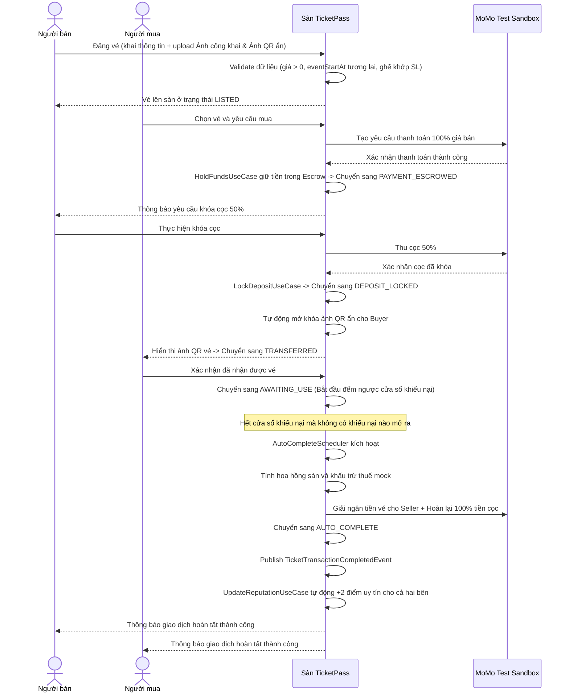

# TicketPass — Sàn Giao Dịch Vé Điện Tử (Ticket Marketplace)

TicketPass là một web application viết bằng **Java 17 / Spring Boot 3.3.4**, đóng vai trò **sàn trung gian giao dịch chuyển nhượng (pass lại) vé điện tử** theo mô hình marketplace dành cho ba loại vé chính: **vé xem phim (`MOVIE`)**, **vé concert / âm nhạc (`CONCERT`)**, và **vé xe khách (`BUS`)**.

Dự án giải quyết bài toán nhức nhối của việc pass vé tự phát trên các hội nhóm Facebook và Zalo: người mua phải chuyển tiền trước khi có bất kỳ bằng chứng nào về chất lượng vé, người bán sau khi nhận tiền có thể biến mất hoặc chuyển vé đã sử dụng, và không có bất kỳ cơ chế nào đứng giữa để bảo vệ quyền lợi hai bên. 

TicketPass đảo ngược cấu trúc rủi ro đó bằng **mô hình bảo vệ kinh tế 2 lớp cốt lõi**:
1. **Ký quỹ 100% của người mua (`PAYMENT_ESCROWED`)**: Tiền mua vé được sàn giữ trong escrow qua cổng MoMo Sandbox, chỉ giải ngân cho người bán sau khi người mua xác nhận nhận vé và hết cửa sổ khiếu nại hợp lệ.
2. **Khóa cọc 50% của người bán (`DEPOSIT_LOCKED`)**: Người bán bắt buộc phải khóa cọc 50% giá bán trước khi mã vé được giao. Nếu người bán gian lận và thua tranh chấp, toàn bộ tiền cọc sẽ bị tịch thu (vừa bù đắp phí sàn, vừa bồi thường thiệt hại cho người mua). Gian lận chắc chắn sẽ bị lỗ tiền thật.
3. **Cơ chế ảnh hai lớp**: Người bán đăng tải **ảnh công khai** (thông tin sự kiện, rạp/nhà xe, vị trí ghế...) để người mua duyệt trước khi mua, và **ảnh QR ẩn** (mã vé/barcode vào cửa thật) chỉ được sàn tự động mở khóa cho người mua sau khi cả hai điều kiện trên được thỏa mãn.

Đây là **đồ án môn Lập trình hướng đối tượng (OOP)**. Dự án tập trung áp dụng đúng đắn và chặt chẽ bốn design pattern trọng tâm — **Adapter, State, Strategy, Observer** — giải quyết trực tiếp các bài toán nghiệp vụ thực tế trong hệ thống.

---

## 1. Tính năng chính

- **Hỗ trợ 3 loại vé marketplace**:
  - **Vé xem phim (`MOVIE`)**: Tên phim, rạp (chọn danh sách), suất chiếu, số lượng vé, số ghế cụ thể.
  - **Vé concert (`CONCERT`)**: Tên concert, địa điểm, hình thức (ngồi/đứng), khu vực (Line/Zone/Ghế), giờ bắt đầu, số lượng vé.
  - **Vé xe khách (`BUS`)**: Hãng xe, tuyến đường (điểm xuất phát - điểm đến), giờ khởi hành, số lượng chỗ, tên ghế.
  *(Lưu ý: Vé tàu hỏa `TRAIN` đã được đánh dấu deprecated để tinh gọn phạm vi).*
- **Cơ chế bảo vệ kinh tế 2 lớp (Escrow 100% + Cọc 50%)**:
  - Người mua trả 100% giá bán vào Escrow của sàn qua MoMo Test Sandbox.
  - Người bán khóa cọc 50% giá bán để kích hoạt chuyển vé.
- **Cơ chế hiển thị ảnh 2 lớp**:
  - **Ảnh công khai**: Buyer xem trước khi quyết định mua.
  - **Ảnh QR ẩn**: Mã vào cửa thật, chỉ mở khóa cho buyer sau khi hoàn tất thanh toán escrow và người bán đã khóa cọc.
- **Cửa sổ khiếu nại (Dispute Window) có thời hạn theo loại vé**:
  - Phim: 2 giờ; Xe khách: 3 giờ; Concert: 24 giờ.
  - Luôn tự động cắt trước thời điểm sự kiện bắt đầu (`eventStartAt`).
- **Tự động hoàn tất và giải ngân (`AUTO_COMPLETE`)**:
  - Tiến trình scheduler tự động quét và hoàn tất các giao dịch hết cửa sổ khiếu nại mà không có tranh chấp.
  - Tự động hoàn cọc cho seller, tính phí hoa hồng sàn, khấu trừ thuế stub và giải ngân tiền vé.
- **Quy trình xử lý tranh chấp & phán quyết (`DISPUTE_UNDER_REVIEW`)**:
  - Người mua mở khiếu nại kèm bằng chứng (ảnh, tài liệu).
  - Người bán có thời hạn (24 giờ) gửi phản hồi phản biện.
  - Admin xem xét hồ sơ và phán quyết: Hoàn tiền 100% escrow + bồi thường từ cọc bị tịch thu nếu buyer thắng; hoặc giải ngân + hoàn cọc nếu seller thắng.
- **Tính hoa hồng sàn minh bạch theo bậc giá vé**:
  - Bảng phí từ 7% xuống 2% (không lũy tiến), phí tối thiểu 5.000đ, trần hoa hồng 400.000đ, chia đều 50/50 giữa buyer và seller.
- **Hệ thống Điểm uy tín người dùng (Reputation Score)**:
  - Khởi tạo 100.00 điểm, cập nhật tự động sau mỗi giao dịch thành công (+2) hoặc tranh chấp (thua -15, thắng +1) thông qua Spring Domain Events.

> **Ghi chú về module `verification` (OCR, QR duplicate hash, email forward):** Module này hiện được đánh dấu **DEPRECATED** trong codebase khi dự án chuyển hướng tập trung vào mô hình marketplace bảo vệ bằng đòn bẩy kinh tế (cọc + escrow) và cơ chế ảnh hai lớp.

---

## 2. Công nghệ sử dụng

| Thành phần | Công nghệ | Vai trò / Chi tiết |
|---|---|---|
| **Ngôn ngữ** | Java 17 | Nền tảng hướng đối tượng chính |
| **Framework** | Spring Boot 3.3.4 | Khung ứng dụng backend, IoC/DI container |
| **Build tool** | Maven (`.\mvnw`) | Quản lý phụ thuộc và đóng gói ứng dụng qua Maven Wrapper |
| **Cơ sở dữ liệu** | MySQL 8.x | Database chính cho môi trường phát triển và chạy thật |
| **Database cho Test** | H2 Database (in-memory) | Chạy kiểm thử tự động độc lập, không phụ thuộc MySQL |
| **ORM / Data Access** | Spring Data JPA (Hibernate 6) | Ánh xạ đối tượng, cấu hình `ddl-auto=validate` |
| **Database Migration** | Flyway | Quản lý phiên bản schema DB (`V1__init_schema.sql` là source of truth) |
| **Giao diện Web** | Spring Web MVC + Thymeleaf | Server-side rendering (SSR), layout phân quyền với `thymeleaf-extras-springsecurity6` |
| **Bảo mật** | Spring Security | Xác thực form login (session-based), phân quyền vai trò `USER` và `ADMIN` |
| **Cổng thanh toán** | MoMo Test Environment | Môi trường Sandbox thử nghiệm thanh toán Escrow và khóa cọc |
| **Lưu trữ file** | Local File Storage Adapter | Lưu trữ ảnh công khai, ảnh QR ẩn và bằng chứng khiếu nại (`./data/uploads`) |
| **Thư viện tiện ích** | Lombok | Giảm boilerplate code (getter, setter, constructor) |
| **Thư viện bổ trợ** | ZXing, Tess4j (Tesseract) | Tùy chọn legacy cho mã QR và OCR trong module verification |

---

## 3. Yêu cầu môi trường

| Phần mềm | Phiên bản | Lệnh kiểm tra trong terminal |
|---|---|---|
| **JDK** | 17 (khuyến nghị Eclipse Temurin 17) | `java -version` |
| **MySQL** | 8.x | `mysql --version` |
| **Git** | Bất kỳ phiên bản gần đây | `git --version` |

> **Không cần cài đặt Maven:** Repo đã tích hợp sẵn Maven Wrapper (`mvnw`, `mvnw.cmd`, `.mvn/`). Mọi lệnh build/chạy đều sử dụng `.\mvnw` (trên PowerShell/CMD Windows) để đảm bảo đồng nhất phiên bản Maven cho cả nhóm.

---

## 4. Cài đặt môi trường trên Windows

### 4.1 Cài đặt JDK 17
1. Tải bộ cài đặt: [Eclipse Temurin 17 (LTS)](https://adoptium.net/temurin/releases/?version=17) — chọn gói `.msi` (Windows x64).
2. Chạy file cài đặt với các thiết lập mặc định (thường nằm tại `C:\Program Files\Eclipse Adoptium\jdk-17.x.x-hotspot`).
3. Đặt biến môi trường hệ thống `JAVA_HOME`:
   - Mở cửa sổ **System Properties** → **Environment Variables**.
   - Tại mục **System variables**, nhấn **New**:
     - `Variable name`: `JAVA_HOME`
     - `Variable value`: `C:\Program Files\Eclipse Adoptium\jdk-17.x.x-hotspot` (trỏ tới thư mục gốc của JDK, **không** trỏ vào `bin`).
   - Chọn biến `Path` → **Edit** → thêm dòng `%JAVA_HOME%\bin`.
4. Mở cửa sổ **PowerShell mới** và kiểm tra:
   ```powershell
   java -version
   $env:JAVA_HOME
   ```

### 4.2 Cài đặt MySQL 8 và tạo Database
1. Cài đặt MySQL Server 8.x thông qua [MySQL Installer](https://dev.mysql.com/downloads/installer/). Ghi nhớ mật khẩu tài khoản `root`.
2. Đảm bảo dịch vụ MySQL đang chạy (kiểm tra trong `services.msc`).
3. Mở MySQL Command Line hoặc MySQL Workbench, đăng nhập `root` và tạo database với encoding `utf8mb4`:
   ```sql
   CREATE DATABASE ticketpass CHARACTER SET utf8mb4 COLLATE utf8mb4_unicode_ci;
   ```

### 4.3 Cấu hình an toàn với `application-local.properties`
Để tránh xung đột mật khẩu DB hoặc vô tình commit thông tin nhạy cảm (mật khẩu cá nhân, MoMo sandbox key) lên Git:
1. Tạo file `src/main/resources/application-local.properties` (file này **đã nằm trong `.gitignore`**):
   ```properties
   # Cấu hình tài khoản MySQL máy bạn
   spring.datasource.username=root
   spring.datasource.password=mat_khau_mysql_may_ban

   # MoMo Sandbox credentials (nếu có tài khoản riêng)
   app.payment.momo.access-key=CHANGE_ME
   app.payment.momo.secret-key=CHANGE_ME
   ```
2. Ứng dụng sẽ tự động ghi đè các thiết lập này khi chạy với profile `local`.

---

## 5. Khởi chạy ứng dụng

Mở **PowerShell** tại thư mục gốc của project:

### 5.1 Biên dịch và chạy ứng dụng
```powershell
# Biên dịch và tải dependencies
.\mvnw clean install

# Khởi chạy Spring Boot với profile local
.\mvnw spring-boot:run "-Dspring-boot.run.profiles=local"
```
Truy cập ứng dụng tại trình duyệt: **http://localhost:8080**

### Lưu ý quan trọng về lần chạy đầu tiên:
- **Flyway tự động khởi tạo dữ liệu**: Script `src/main/resources/db/migration/V1__init_schema.sql` sẽ tự động tạo đầy đủ các bảng (`users`, `tickets`, `escrow_transactions`, `deposits`, `disputes`, `user_reputation_scores`...). **Không cần chạy script tạo bảng thủ công**.
- **Chế độ `ddl-auto=validate`**: Hibernate chỉ kiểm tra khớp giữa Entity và Schema cơ sở dữ liệu. Không tự ý chỉnh sửa file migration đã merge để tránh lỗi sai lệch checksum của Flyway.

### 5.2 Chạy bộ kiểm thử (Tests)
```powershell
.\mvnw test
```
- Bộ kiểm thử sử dụng **H2 in-memory database** với Flyway tạm tắt và tự động giải phóng sau khi chạy.
- **Không cần bật MySQL để chạy test**. Máy chấm bài hay CI/CD chỉ cần có JDK 17 là có thể chạy pass toàn bộ test suite.

---

## 6. Cấu hình tích hợp

### 6.1 Cổng thanh toán MoMo Test Environment (Sandbox)
MoMo Test Sandbox được tích hợp thông qua `PaymentGateway` (`MomoTestGatewayAdapter`). Mọi giao dịch chỉ mang tính mô phỏng, **hoàn toàn không phát sinh tiền thật**.
```properties
app.payment.momo.gateway-name=MOMO_TEST
app.payment.momo.endpoint=https://test-payment.momo.vn/v2/gateway/api/create
app.payment.momo.partner-code=MOMO_TEST_PARTNER
app.payment.momo.access-key=CHANGE_ME
app.payment.momo.secret-key=CHANGE_ME
app.payment.momo.return-url=http://localhost:8080/payment/momo/return
app.payment.momo.ipn-url=http://localhost:8080/payment/momo/ipn
```

### 6.2 Cấu hình lưu trữ File (Ảnh công khai & Ảnh QR ẩn)
Ảnh vé công khai, ảnh QR ẩn và tài liệu bằng chứng được quản lý qua `FileStorageService` (`LocalFileStorageAdapter`):
```properties
app.storage.local.base-dir=./data/uploads
app.storage.local.public-url-prefix=/files
spring.servlet.multipart.max-file-size=25MB
spring.servlet.multipart.max-request-size=60MB
```
Thư mục `./data/uploads` sẽ tự động được tạo khi có yêu cầu upload file.

---

## 7. Luồng nghiệp vụ & Vòng đời vé (State Machine)

### 7.1 Sơ đồ 9 trạng thái của vé
Vòng đời của mỗi vé được quản lý nghiêm ngặt bởi `TicketStateMachineService` với 9 trạng thái:

```
                  ┌──────────────────────┐
                  │        LISTED        │  (Người bán đăng vé thành công)
                  └──────────┬───────────┘
                             │  [Buyer thanh toán 100% qua MoMo]
                             ▼
                  ┌──────────────────────┐
                  │   PAYMENT_ESCROWED   │  (Sàn giữ tiền trong Escrow)
                  └──────────┬───────────┘
                             │  [Seller khóa cọc 50%]
                             ▼
                  ┌──────────────────────┐
                  │    DEPOSIT_LOCKED    │  (Đã khóa cọc bảo đảm)
                  └──────────┬───────────┘
                             │  [Sàn tự động mở khóa ảnh QR ẩn cho Buyer]
                             ▼
                  ┌──────────────────────┐
                  │     TRANSFERRED      │  (Đã giao vé)
                  └──────────┬───────────┘
                             │  [Buyer xác nhận đã nhận vé]
                             ▼
                  ┌──────────────────────┐
                  │     AWAITING_USE     │  (Cửa sổ khiếu nại bắt đầu đếm)
                  └──────┬────────┬──────┘
                         │        │
  [Hết hạn khiếu nại,   │        │ [Buyer mở khiếu nại trong thời hạn]
   không có tranh chấp] │        ▼
                         │    ┌─────────────────────────┐
                         │    │  DISPUTE_UNDER_REVIEW   │  (Admin thụ lý khiếu nại)
                         │    └────┬───────────────┬────┘
                         │         │               │
                         │   [Buyer thắng]   [Seller thắng]
                         │         ▼               ▼
                         │    ┌──────────┐   ┌──────────┐
                         │    │ RESOLVED │   │ RESOLVED │
                         │    │  _BUYER  │   │ _SELLER  │
                         │    │  _WINS   │   │  _WINS   │
                         │    └──────────┘   └──────────┘
                         ▼
             ┌────────────────────────┐
             │     AUTO_COMPLETE      │  (Giải ngân cho seller + hoàn cọc + cộng điểm uy tín)
             └────────────────────────┘
```

### 7.2 Luồng giao dịch mua bán thành công (Sequence Diagram)


---

## 8. Các quy tắc nghiệp vụ trọng tâm (Business Rules)

### 8.1 Bảng hoa hồng sàn (Commission Tiers)
Sàn thu hoa hồng theo bảng tra giá vé (không lũy tiến), chia đều 50/50 giữa người mua và người bán:
| Bậc giá vé | Điều kiện giá bán | Tỷ lệ hoa hồng | Ghi chú |
|---|---|:---:|---|
| `UNDER_1M` | Dưới 1.000.000 VNĐ | **7%** | Phí tối thiểu: **5.000 VNĐ** |
| `UNDER_5M` | Từ 1.000.000 đến dưới 5.000.000 VNĐ | **5%** | Chia đôi: Buyer chịu 50%, Seller chịu 50% |
| `UNDER_10M` | Từ 5.000.000 đến dưới 10.000.000 VNĐ | **3%** | |
| `FROM_10M` | Từ 10.000.000 VNĐ trở lên | **2%** | Trần hoa hồng tối đa: **400.000 VNĐ** |

### 8.2 Cửa sổ khiếu nại theo loại vé (Dispute Window)
Cửa sổ khiếu nại bắt đầu đếm khi buyer bấm xác nhận đã nhận vé (`AWAITING_USE`):
- **Vé xem phim (`MOVIE`)**: **2 giờ** (thường dùng ngay trong ngày).
- **Vé xe khách (`BUS`)**: **3 giờ**.
- **Vé concert (`CONCERT`)**: **24 giờ** (giá trị cao, cần thời gian kiểm tra kỹ với ban tổ chức).
- **Quy tắc chặn an toàn:** Cửa sổ khiếu nại **luôn kết thúc trước thời điểm bắt đầu sự kiện (`eventStartAt`)** để ngăn chặn lạm dụng (người mua đi xem xong rồi mới mở khiếu nại).
- **Hạn phản hồi của seller:** Khi có khiếu nại, seller có tối đa **24 giờ** để gửi bằng chứng phản biện.

### 8.3 Công thức tịch thu cọc khi người bán gian lận (Dispute Buyer Wins)
Khi admin kết luận người bán gian lận (vé giả, vé đã quét, thông tin sai lệch):
- Tiền escrow: **Hoàn lại 100% cho người mua**.
- Tiền cọc 50% của người bán bị tịch thu và chia theo công thức:
  - Phí xử lý của sàn (`founder_cut`) = `max(5.000 VNĐ, 7% * tổng tiền cọc)` (chặn không vượt quá tổng cọc).
  - Bồi thường cho người mua (`buyer_compensation`) = `tổng tiền cọc - founder_cut`.
  - Người mua nhận: `100% Escrow + buyer_compensation`.

### 8.4 Hệ thống thang điểm uy tín (Reputation Score)
- Điểm khởi tạo cho tài khoản mới: **100.00** điểm (thang điểm 0 - 100).
- **Giao dịch hoàn tất thành công (`AUTO_COMPLETE`)**: **+2.00** điểm (cộng cho cả buyer và seller).
- **Thắng tranh chấp (`RESOLVED_SELLER_WINS` hoặc buyer thắng)**: **+1.00** điểm.
- **Tự ý hủy vé sau khi người mua đã thanh toán escrow**: **-10.00** điểm.
- **Thua tranh chấp do gian lận**: **-15.00** điểm.
- *Thiết kế mang tính răn đe bất đối xứng:* Cần 8 giao dịch sạch (+2) mới bù lại được 1 lần gian lận (-15). Điểm uy tín được lắng nghe và cập nhật bất đồng bộ an toàn qua Spring Domain Events.

---

## 9. Cấu trúc thư mục & Kiến trúc mã nguồn

Dự án áp dụng phong cách kiến trúc **Clean / Hexagonal Architecture** chia theo từng module nghiệp vụ:

```
project_oop/
├── mvnw, mvnw.cmd, .mvn/          # Maven Wrapper
├── pom.xml                        # Khai báo dependency và build cấu hình
├── design-note/                   # 10 tài liệu phân tích & thiết kế chi tiết
│   └── dev-logs/                  # Nhật ký phát triển cá nhân của từng thành viên
└── src/
    ├── main/
    │   ├── java/com/yourapp/ticketpass/
    │   │   ├── TicketPassApplication.java   # Điểm khởi động Spring Boot
    │   │   ├── ticket/         # Module Vé: 3 adapter loại vé, state machine, chuyển nhượng
    │   │   ├── payment/        # Module Thanh toán: Escrow, cọc, hoa hồng, thuế, MoMo sandbox
    │   │   ├── dispute/        # Module Tranh chấp: Mở khiếu nại, phản hồi, phán quyết, auto scheduler
    │   │   ├── reputation/     # Module Uy tín: Điểm uy tín, lịch sử, listener domain events
    │   │   ├── user/           # Module Người dùng: Đăng ký, đăng nhập, phân quyền, hồ sơ
    │   │   ├── shared/         # Hạ tầng dùng chung: Config, DTO, Events, Exceptions, Storage, Utils
    │   │   └── verification/   # [DEPRECATED] Module xác thực kỹ thuật (OCR, QR hash)
    │   └── resources/
    │       ├── application.properties           # Cấu hình chính của hệ thống
    │       ├── application-local.properties     # Cấu hình cá nhân máy local (gitignored)
    │       ├── db/migration/V1__init_schema.sql # Flyway migration tạo toàn bộ bảng DB
    │       ├── templates/                       # View giao diện Thymeleaf (SSR)
    │       │   ├── layout/base.html             # Layout khung dùng chung
    │       │   └── auth/                        # Trang login, register
    │       └── static/                          # CSS, JS, hình ảnh
    └── test/
        ├── java/                                # Bộ kiểm thử đơn vị & tích hợp
        └── resources/application.properties     # Cấu hình kiểm thử (H2 in-memory)
```

Mỗi module nghiệp vụ (`ticket`, `payment`, `dispute`, `user`, `reputation`) đều được tổ chức phân lớp độc lập:
- `domain`: Chứa các Entity, Enum, và Interface Port (`TicketRepository`, `PaymentGateway`...). **Không phụ thuộc Spring Framework**.
- `adapter`: Hiện thực cụ thể của các port kết nối ra bên ngoài (`MovieTicketAdapter`, `MomoTestGatewayAdapter`...).
- `application`: Use Cases và Services điều phối nghiệp vụ (`HoldFundsUseCase`, `TicketStateMachineService`...). Nơi quản lý transaction (`@Transactional`).
- `infrastructure`: Hiện thực repository (`*RepositoryImpl`) kết hợp Spring Data JPA (`*JpaRepository`).
- `web`: Controllers và DTOs request/response phục vụ giao diện người dùng.

### 4 Nguyên tắc kiến trúc cốt lõi:
1. **Liên kết module bằng ID thuần (`Long`)**: Tuyệt đối không dùng JPA `@ManyToOne` hay `@OneToMany` xuyên module (ví dụ: `Ticket` chỉ lưu `Long sellerId`, `Long escrowTransactionId`). Loại bỏ hoàn toàn lazy loading xuyên module và cyclic dependency.
2. **Side-effects đi qua Domain Event**: Module `payment` publish `TicketTransactionCompletedEvent`, module `reputation` lắng nghe bằng `@TransactionalEventListener(phase = AFTER_COMMIT)`. Nếu module uy tín lỗi thì tiền vẫn giải ngân an toàn.
3. **Trừu tượng hóa lưu trữ file**: Không bao giờ thao tác trực tiếp với đường dẫn ổ đĩa vật lý trong business logic; mọi file đều đi qua interface `FileStorageService`.
4. **Quản lý Session Spring Security**: Kiểm soát xác thực dựa trên session với hai vai trò tối giản `ROLE_USER` và `ROLE_ADMIN`.

---

## 10. Design Patterns trọng tâm (Môn OOP)

Dự án hiện thực bốn design pattern trọng tâm nhằm giải quyết các bài toán thiết kế cụ thể:

| Pattern | Nơi áp dụng trong code | Vấn đề thực tế giải quyết |
|---|---|---|
| **Adapter** | • `ticket/domain/TicketAdapter` (`MovieTicketAdapter`, `ConcertTicketAdapter`, `BusTicketAdapter`)<br>• `payment/domain/PaymentGateway` (`MomoTestGatewayAdapter`)<br>• `shared/storage/FileStorageService` (`LocalFileStorageAdapter`) | • Chuẩn hóa xử lý các loại vé khác nhau về chung một giao diện thống nhất.<br>• Giúp hệ thống dễ dàng thay đổi cổng thanh toán (từ MoMo sang VNPay, ZaloPay) hoặc lưu trữ file (từ Local sang AWS S3) mà không sửa business logic. |
| **State** | • `ticket/domain/TicketStatus`<br>• `ticket/application/TicketStateMachineService`<br>• `ticket/domain/IllegalTicketTransitionException` | Tập trung hóa toàn bộ logic và điều kiện chuyển đổi trạng thái giao dịch (9 trạng thái) vào một nơi duy nhất. Ngăn chặn triệt để tình trạng nhảy cóc trạng thái hoặc cập nhật sai luồng. |
| **Strategy** | • `dispute/domain/DisputeWindowPolicy`<br>• `payment/application/CommissionCalculatorService`<br>• `payment/application/ForfeitDepositPolicy` | • Cho phép thay đổi thuật toán tính cửa sổ khiếu nại tùy biến theo từng loại vé (2h, 3h, 24h).<br>• Linh hoạt điều chỉnh bảng hoa hồng và cách phân chia cọc phạt mà không làm ảnh hưởng đến các service gọi. |
| **Observer** | • `shared/event/TicketTransactionCompletedEvent`<br>• `shared/event/DisputeResolvedEvent`<br>• `reputation/application/UpdateReputationUseCase` | Giảm khớp nối (loose coupling) giữa luồng thanh toán tiền bạc và luồng tính điểm uy tín. Giúp hệ thống mở rộng thêm các tính năng như gửi email, gửi thông báo mà không sửa mã nguồn của module thanh toán. |

---

## 11. Xử lý sự cố thường gặp (Troubleshooting)

| Triệu chứng lỗi | Nguyên nhân | Cách khắc phục |
|---|---|---|
| Ứng dụng không khởi động: `Schema-validation: missing table` hoặc `missing column` | Hibernate bật `ddl-auto=validate` và phát hiện sai lệch giữa Entity và schema database MySQL, hoặc Flyway chưa chạy. | Kiểm tra DB `ticketpass` đã được tạo chưa. Kiểm tra bảng `flyway_schema_history`. Nếu cần debug, tạm đặt `spring.jpa.hibernate.ddl-auto=none`, kiểm tra trường bị thiếu và đối chiếu lại file migration `V1__init_schema.sql`. |
| `Access denied for user 'root'@'localhost'` | Sai tài khoản hoặc mật khẩu MySQL trong file cấu hình. | Cập nhật chính xác `spring.datasource.password` trong file `application-local.properties` cho khớp với mật khẩu máy bạn. |
| `Unknown database 'ticketpass'` | Chưa tạo cơ sở dữ liệu `ticketpass`. | Đăng nhập MySQL và chạy lệnh: `CREATE DATABASE ticketpass CHARACTER SET utf8mb4 COLLATE utf8mb4_unicode_ci;`. |
| Lỗi biên dịch: `cannot find symbol: method getXxx()` dù class có `@Getter` / `@Data` | IDE chưa bật tính năng **Annotation Processing** của Lombok. | **IntelliJ IDEA**: Vào `Settings` → `Build, Execution, Deployment` → `Compiler` → `Annotation Processors` → Tích chọn **Enable annotation processing** và cài đặt Lombok plugin, sau đó Restart IDE. |
| Lỗi `JAVA_HOME not found` hoặc `variable is not defined correctly` | Chưa cấu hình hoặc cấu hình sai biến môi trường `JAVA_HOME`. | Đặt lại biến `JAVA_HOME` trỏ đúng vào thư mục gốc của JDK 17 (không trỏ vào thư mục `bin`), sau đó **tắt và mở lại cửa sổ PowerShell mới**. |
| PowerShell báo `mvnw : The term 'mvnw' is not recognized` | Gõ thiếu tiền tố `.\` khi chạy file script trên PowerShell. | Luôn gõ có tiền tố: `.\mvnw` và đảm bảo terminal đang đứng ở thư mục gốc chứa file `mvnw.cmd`. |
| Lỗi khi upload ảnh vé: Multipart exception | Kích thước file vượt quá cấu hình tối đa hoặc thiếu quyền ghi thư mục. | File tối đa 25MB (`spring.servlet.multipart.max-file-size`). Thư mục `./data/uploads` sẽ tự sinh; kiểm tra quyền ghi của user hệ thống. |

---

## 12. Tài liệu thiết kế kỹ thuật (`design-note/`)

Toàn bộ chi tiết kỹ thuật, hợp đồng giao tiếp giữa các module và quy ước đã được lưu trữ đầy đủ trong thư mục `design-note/`:

| Tài liệu | Nội dung chi tiết |
|---|---|
| [`00-tong-quan-du-an.md`](design-note/00-tong-quan-du-an.md) | **Tài liệu đọc đầu tiên.** Tổng quan bài toán, mục tiêu đồ án OOP, phạm vi trong/ngoài, luồng mua bán 7 bước, cơ chế bảo vệ kinh tế. |
| [`01-kien-truc-he-thong.md`](design-note/01-kien-truc-he-thong.md) | Kiến trúc phân lớp Clean/Hexagonal, ma trận import giữa các module, 4 nguyên tắc bất khả xâm phạm. |
| [`02-hop-dong-module.md`](design-note/02-hop-dong-module.md) | **Hợp đồng giao tiếp giữa các module.** Định nghĩa các interface port, DTO và Domain Events dùng chung. |
| [`03-database-schema.md`](design-note/03-database-schema.md) | Sơ đồ ERD, mô tả chi tiết các bảng và quyền sở hữu bảng của từng module. |
| [`04-quy-tac-nghiep-vu.md`](design-note/04-quy-tac-nghiep-vu.md) | Danh sách quy tắc nghiệp vụ BR-01 đến BR-11: công thức hoa hồng, cọc, tịch thu cọc, thuế, thang điểm uy tín, cửa sổ khiếu nại. |
| [`05-state-machine-giao-dich.md`](design-note/05-state-machine-giao-dich.md) | Chi tiết 9 trạng thái của vé, bảng ma trận chuyển đổi hợp lệ và các bất biến giao dịch. |
| [`06-quy-uoc-code-va-git.md`](design-note/06-quy-uoc-code-va-git.md) | Quy ước đặt tên, kiểu dữ liệu (`BigDecimal`, `Instant`), quy trình Git branch, merge conflict resolution. |
| [`07-phan-cong-cong-viec.md`](design-note/07-phan-cong-cong-viec.md) | Phân công module, danh mục file sở hữu và danh sách nhiệm vụ của từng thành viên. |
| [`08-ke-hoach-tich-hop.md`](design-note/08-ke-hoach-tich-hop.md) | Kịch bản kiểm thử End-to-End, quy trình tích hợp hằng tuần, 3 trường hợp biên quan trọng. |
| [`09-oop-design-patterns.md`](design-note/09-oop-design-patterns.md) | Bảng tổng kết các design pattern và nguyên lý OOP dùng để bảo vệ đồ án trước hội đồng. |

---

## 13. Phân công nhóm & Nhật ký phát triển

Dự án được xây dựng bởi nhóm 3 thành viên, phân chia theo **module nghiệp vụ toàn trình (vertical slice)** để tối ưu hóa tính độc lập và hạn chế tối đa xung đột mã nguồn:

| Thành viên | Nhánh Git | Module phụ trách | Design Pattern trọng tâm | Nhiệm vụ chính |
|---|---|---|---|---|
| **Hoàng Thế Ngọc** (`ngocht`) | `ngocht` | `ticket` | Adapter, State, Strategy | Vòng đời vé, 3 adapter loại vé (`Movie`, `Concert`, `Bus`), State Machine 9 trạng thái, kiểm tra điều kiện đăng vé, chuyển nhượng vé. |
| **Minh Tuấn** (`MinhTuan`) | `MinhTuan` | `payment`, `dispute` | Adapter, Strategy | Dòng tiền: Escrow, khóa cọc 50%, tính hoa hồng, khấu trừ thuế stub, giải ngân, MoMo Sandbox adapter, quy trình khiếu nại và tự động hoàn tất. |
| **Hà Linh** (`Halinh`) | `Halinh` | `user`, `reputation`, `web`, `shared` | Observer, Adapter | Quản lý người dùng, Spring Security session, lưu file, tính điểm uy tín qua Domain Events, giao diện Thymeleaf và xử lý ngoại lệ toàn cục. |

### Nhật ký phát triển cá nhân (Dev Logs)
Mỗi thành viên cập nhật tiến độ công việc và lý do đưa ra các quyết định thiết kế tại:
- [`nhat-ky-nguoi-a.md`](design-note/dev-logs/nhat-ky-nguoi-a.md) — Module `ticket`
- [`nhat-ky-nguoi-b.md`](design-note/dev-logs/nhat-ky-nguoi-b.md) — Module `payment`, `dispute`
- [`nhat-ky-nguoi-c.md`](design-note/dev-logs/nhat-ky-nguoi-c.md) — Module `user`, `reputation`, `web`, `shared`
