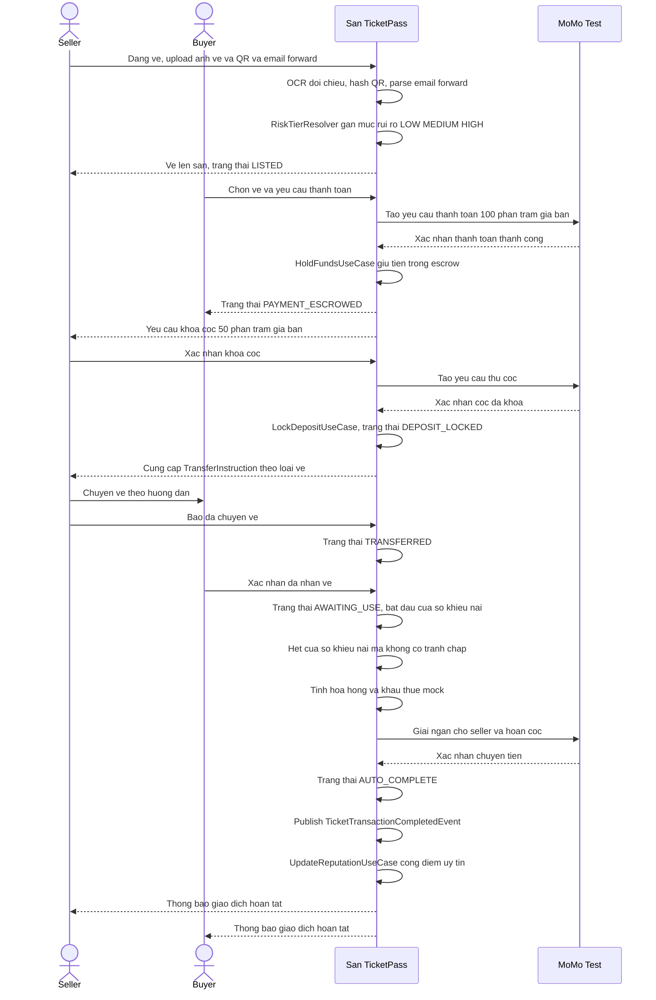

# Tổng quan dự án TicketPass

Tài liệu mở đầu, dành cho người mới tiếp cận dự án (thành viên nhóm, giảng viên hướng dẫn, hội đồng bảo vệ) muốn hiểu nhanh sản phẩm làm gì, giải quyết vấn đề gì và gồm những phần nào.

## 1. Mục tiêu đồ án

TicketPass là một web application viết bằng Java Spring Boot, đóng vai trò **sàn pass (chuyển nhượng/mua bán lại) vé điện tử** cho bốn loại vé: vé phim, vé concert, vé tàu và vé xe khách.

Mục tiêu của đồ án gồm hai phần song song:

- **Mục tiêu nghiệp vụ:** xây dựng một sàn trung gian đủ tin cậy để hai người xa lạ có thể mua bán lại vé điện tử mà không phải tin nhau, bằng cách kết hợp xác thực vé đầu vào, giữ tiền (escrow), cọc của người bán và cơ chế khiếu nại có thời hạn.
- **Mục tiêu học thuật (môn OOP):** áp dụng đúng và có lý do các nguyên lý thiết kế hướng đối tượng — đóng gói, trừu tượng hoá qua interface, đa hình — cùng bốn design pattern trọng tâm: **Adapter**, **State**, **Strategy**, **Observer**. Mỗi pattern trong dự án phải giải quyết một vấn đề thật, không phải nhồi vào cho đủ số lượng.

## 2. Bài toán thực tế và vì sao cần sàn trung gian

Hiện nay, khi một người không dùng được vé đã mua (đổi kế hoạch, trùng lịch, ốm), kênh bán lại phổ biến nhất là các hội nhóm trên Facebook và Zalo. Kênh này không có bất kỳ cơ chế bảo vệ nào, dẫn tới bốn kiểu lừa đảo lặp lại thường xuyên:

1. **Vé giả:** người bán dựng ảnh vé bằng công cụ chỉnh sửa, hoặc gửi mã QR không hợp lệ.
2. **Vé đã sử dụng:** vé thật, mã QR thật, nhưng đã được quét vào cửa trước khi người mua tới.
3. **Bán trùng một vé cho nhiều người:** cùng một mã QR được bán cho ba, bốn người mua; chỉ người vào cửa đầu tiên dùng được.
4. **Nhận tiền rồi biến mất:** người mua chuyển khoản trước, người bán chặn liên lạc.

Điểm chung của cả bốn kiểu là: **người mua phải trả tiền trước khi có bất kỳ bằng chứng nào về chất lượng vé, và không có ai đứng giữa để đòi lại tiền.** Người mua chịu toàn bộ rủi ro, người bán gian không mất gì.

Sàn trung gian đảo ngược cấu trúc rủi ro này:

- Tiền của người mua **không đến tay người bán ngay**, mà được sàn giữ trong escrow cho đến khi người mua xác nhận vé dùng được và hết thời hạn khiếu nại.
- Người bán phải **khoá cọc 50% giá bán** trước khi được chuyển vé. Nếu người bán gian và thua tranh chấp, cọc bị tịch thu để bồi thường người mua. Người bán gian không còn "mất không gì cả" mà mất tiền thật.
- Vé được **xác thực nhiều lớp ngay từ khi đăng**, nên phần lớn vé giả và vé bán trùng bị loại trước khi có người mua.
- Có **quy trình khiếu nại rõ ràng** với bằng chứng, thời hạn phản hồi và người phán quyết.

Sàn thu hoa hồng theo bậc giá vé để duy trì hoạt động, chia đôi giữa người mua và người bán.

## 3. Phạm vi TRONG đồ án

Những chức năng được hiện thực đầy đủ và có thể demo:

- **Quản lý người dùng:** đăng ký, đăng nhập (session-based), phân quyền theo vai, xem và cập nhật thông tin cá nhân.
- **Đăng vé bán lại:** người bán khai thông tin vé, upload ảnh vé, upload ảnh/mã QR, tuỳ chọn forward email xác nhận từ nhà cung cấp.
- **Xác thực vé nhiều lớp:** OCR ảnh vé và đối chiếu với thông tin người bán khai, hash payload QR để phát hiện vé đã từng được đăng, parse nội dung email forward, phân bậc rủi ro LOW/MEDIUM/HIGH và quyết định auto-approve hay bắt buộc admin duyệt tay.
- **Thanh toán escrow:** người mua thanh toán 100% giá bán qua MoMo Test Environment, tiền vào escrow của sàn.
- **Cọc người bán:** khoá cọc 50% giá bán trước khi chuyển vé.
- **Chuyển vé theo loại:** mỗi loại vé có hướng dẫn chuyển nhượng riêng, sinh ra bởi Adapter tương ứng.
- **Hoàn tất tự động:** hết cửa sổ khiếu nại mà không có tranh chấp thì hệ thống tính hoa hồng, khấu thuế (mock), giải ngân cho người bán, hoàn cọc.
- **Khiếu nại và phán quyết:** người mua nộp bằng chứng (ảnh, video), người bán phản hồi trong thời hạn, admin phán quyết, hệ thống thực thi hoàn tiền hoặc tịch thu cọc theo công thức đã chốt.
- **Điểm uy tín:** tự động cộng/trừ điểm sau mỗi giao dịch hoặc tranh chấp, cập nhật bất đồng bộ qua domain event.
- **Giao diện web:** các trang Thymeleaf cho toàn bộ luồng trên, gồm cả trang quản trị để duyệt vé rủi ro cao và xử lý tranh chấp.

## 4. Phạm vi NGOÀI đồ án

Những phần dưới đây **cố tình không làm**. Đây là quyết định phạm vi có chủ ý, không phải thiếu sót:

- **Thanh toán thật:** chỉ dùng MoMo Test Environment. Tích hợp cổng thanh toán thật đòi hỏi tài khoản doanh nghiệp, hợp đồng và kiểm định, nằm ngoài khả năng của một nhóm sinh viên.
- **KYC thật:** không xác minh giấy tờ tuỳ thân, không đối chiếu CCCD với cơ sở dữ liệu quốc gia. Người dùng chỉ cần email hợp lệ.
- **Thuế thật:** `TaxWithholdingService` là stub với tỷ lệ cấu hình được, không phản ánh quy định thuế thực tế của Việt Nam.
- **Ứng dụng mobile:** chỉ có web responsive, không có app iOS/Android.
- **Chat realtime giữa người mua và người bán:** trao đổi diễn ra qua kênh ngoài sàn; sàn chỉ ghi nhận bằng chứng khi có khiếu nại.
- **Tìm kiếm nâng cao / Elasticsearch:** chỉ có lọc và tìm kiếm cơ bản bằng truy vấn JPA trên MySQL. Không có full-text search, gợi ý, xếp hạng theo độ liên quan.
- **Thông báo đẩy, email marketing, hệ thống khuyến mãi.**

## 5. Các vai trong hệ thống

Hệ thống chỉ có **hai vai kỹ thuật** trong enum `UserRole`:

| Vai (`UserRole`) | Quyền hạn chính |
|---|---|
| **`USER`** | Đăng vé bán lại, thanh toán mua vé, khoá cọc, chuyển vé, xác nhận đã nhận, mở khiếu nại, phản hồi khiếu nại, xem lịch sử giao dịch và điểm uy tín của mình. |
| **`ADMIN`** | Toàn bộ quyền của `USER`, cộng thêm: duyệt tay các vé bị phân loại rủi ro HIGH, xem toàn bộ hồ sơ xác thực, phán quyết tranh chấp, xem báo cáo hoa hồng. Không được tự tay sửa trạng thái vé ngoài quy trình. |

"Người bán" (seller) và "người mua" (buyer) **không phải là vai của tài khoản** mà là **vị trí trong một giao dịch cụ thể**: người tạo listing là seller của giao dịch đó, người thanh toán vào escrow là buyer. Cùng một tài khoản `USER` có thể là seller của giao dịch này và buyer của giao dịch khác. Quyết định này giữ cho `UserRole` đơn giản và tránh phải cấp/thu hồi vai mỗi khi người dùng đổi ý định sử dụng sàn.

Khách chưa đăng nhập (guest) không có bản ghi `User` nào; họ chỉ xem được danh sách vé đang bán và trang chi tiết vé công khai, mọi hành động khác đều bị `SecurityConfig` chặn và chuyển hướng về trang đăng nhập.

## 6. Luồng nghiệp vụ tổng quan

### Bước 1 — Người bán đăng vé và hệ thống xác thực

Người bán khai thông tin vé (loại vé, sự kiện, giờ diễn/khởi hành, thông tin ghế, giá gốc, giá bán) và upload ảnh vé, ảnh hoặc payload mã QR, tuỳ chọn forward email xác nhận từ nhà cung cấp. Hệ thống chạy OCR trên ảnh vé để đối chiếu với thông tin người bán khai, hash payload QR để kiểm tra vé này đã từng được đăng trên sàn chưa, và parse email forward nếu có. `RiskTierResolver` tổng hợp các tín hiệu và gán mức rủi ro LOW, MEDIUM hoặc HIGH. Vé rủi ro HIGH phải qua admin duyệt tay mới được lên sàn.

### Bước 2 — Người mua thanh toán vào escrow

Người mua chọn vé và thanh toán **100% giá bán** qua MoMo Test Environment. Tiền không đến người bán mà được sàn giữ trong escrow. Vé chuyển sang trạng thái `PAYMENT_ESCROWED`.

### Bước 3 — Người bán khoá cọc

Người bán khoá cọc bằng **50% giá bán**. Vé chuyển sang `DEPOSIT_LOCKED`. Cọc là đòn bẩy kinh tế cốt lõi: nó khiến việc lừa đảo trở nên bất lợi cho chính người bán, vì nếu thua tranh chấp thì cọc bị tịch thu.

### Bước 4 — Người bán chuyển vé

Người bán thực hiện chuyển nhượng vé cho người mua theo hướng dẫn do `TicketAdapter` của loại vé tương ứng sinh ra (mỗi nhà cung cấp có quy trình đổi tên/chuyển vé khác nhau). Vé chuyển sang `TRANSFERRED`.

### Bước 5 — Người mua xác nhận đã nhận

Người mua xác nhận đã nhận được vé. Vé chuyển sang `AWAITING_USE` và **cửa sổ khiếu nại bắt đầu đếm**, độ dài tuỳ theo loại vé.

### Bước 6 — Hoàn tất tự động

Nếu hết cửa sổ khiếu nại mà không có tranh chấp nào được mở, hệ thống chuyển vé sang `AUTO_COMPLETE`: tính hoa hồng theo bậc giá vé, khấu thuế (mock), giải ngân phần còn lại cho người bán, hoàn cọc cho người bán, rồi publish `TicketTransactionCompletedEvent`. Module `reputation` lắng nghe event này và cộng điểm uy tín cho cả hai bên.

### Bước 7 — Khiếu nại và phán quyết

Nếu người mua mở khiếu nại trong cửa sổ, vé chuyển sang `DISPUTE_UNDER_REVIEW`. Người mua nộp bằng chứng, người bán phản hồi trong thời hạn quy định, admin xem xét và phán quyết:

- **Người mua thắng:** hoàn 100% escrow cho người mua và tịch thu cọc người bán theo công thức đã chốt (một phần là phí xử lý của sàn, phần còn lại bồi thường người mua). Vé chuyển sang `RESOLVED_BUYER_WINS`.
- **Người bán thắng:** giải ngân và hoàn cọc như trường hợp hoàn tất bình thường. Vé chuyển sang `RESOLVED_SELLER_WINS`.

### Sơ đồ luồng mua bán thành công

## 7. Năm lớp chống scam

Hệ thống không dựa vào một biện pháp duy nhất mà xếp năm lớp bảo vệ, mỗi lớp chặn một kiểu lừa đảo khác nhau. Một kẻ gian phải vượt qua cả năm lớp mới thành công.

### Lớp 1 — OCR đối chiếu thông tin vé

Ảnh vé được đưa qua OCR (Tesseract, có thể thay bằng Cloud Vision) để trích xuất tên sự kiện, ngày giờ, thông tin ghế, mã vé. Kết quả được đối chiếu với thông tin người bán tự khai.

**Chặn được:** vé giả dựng bằng công cụ chỉnh sửa và vé khai sai lệch. Kẻ gian không thể khai "concert hạng VIP, ghế A1" rồi upload ảnh vé hạng thường, vì OCR sẽ phát hiện không khớp. Vé dựng thô sơ thường cho confidence OCR rất thấp hoặc không đọc ra được trường nào, cũng bị đánh dấu.

### Lớp 2 — Hash payload QR chống bán trùng

Payload của mã QR được hash và lưu lại. Trước khi cho vé lên sàn, hệ thống kiểm tra hash này đã tồn tại trong cơ sở dữ liệu chưa.

**Chặn được:** bán trùng một vé cho nhiều người. Nếu cùng một mã QR được đăng lần thứ hai (dù bởi cùng người bán hay người bán khác), hệ thống phát hiện trùng và tự động đẩy vé vào bậc rủi ro HIGH, buộc admin duyệt tay. Đây là kiểu scam khó phát hiện nhất trên các hội nhóm mạng xã hội, vì mỗi người mua chỉ thấy giao dịch của riêng mình.

### Lớp 3 — Xác thực email forward từ nhà cung cấp

Người bán forward email xác nhận đơn hàng gốc từ nhà cung cấp (CGV, Ticketbox, đường sắt Việt Nam...). `EmailForwardParserService` parse nội dung để đối chiếu mã đơn, tên sự kiện và thông tin ghế.

**Chặn được:** vé không có nguồn gốc hợp pháp. Ảnh vé có thể chỉnh sửa, nhưng email xác nhận có đầy đủ metadata người gửi và cấu trúc nội dung đặc trưng của nhà cung cấp thì khó giả hơn nhiều. Vé **không có** email forward xác thực bị tự động xếp vào bậc rủi ro HIGH.

### Lớp 4 — Cọc 50% của người bán

Người bán phải khoá cọc bằng 50% giá bán trước khi được chuyển vé.

**Chặn được:** toàn bộ các kiểu scam mà kẻ gian tính "mất không gì cả". Trên hội nhóm Facebook, kẻ gian chỉ mất một tài khoản ảo. Trên sàn này, nếu thua tranh chấp thì cọc bị tịch thu, nên hành vi lừa đảo trở thành lỗ. Đây là lớp bảo vệ mang tính **kinh tế** chứ không phải kỹ thuật, và cũng là lớp mạnh nhất vì nó tác động vào động cơ lừa đảo chứ không chỉ chặn hành vi.

### Lớp 5 — Escrow kết hợp khiếu nại có cửa sổ thời gian

Tiền của người mua được sàn giữ trong escrow và chỉ giải ngân sau khi hết cửa sổ khiếu nại. Trong cửa sổ đó, người mua có quyền mở tranh chấp kèm bằng chứng.

**Chặn được:** nhận tiền rồi biến mất, và vé đã sử dụng. Người bán biến mất sau khi nhận tiền là không thể, vì tiền chưa từng đến tay họ. Vé đã bị quét trước đó thì người mua phát hiện tại cửa và mở khiếu nại kịp thời, escrow được hoàn 100%. Cửa sổ khiếu nại có độ dài khác nhau theo loại vé và luôn kết thúc trước giờ diễn/giờ khởi hành, vì sau thời điểm đó không còn cách kiểm chứng vé có dùng được hay không.

## 8. Tech stack

| Thành phần | Công nghệ | Vai trò trong dự án |
|---|---|---|
| Ngôn ngữ | Java 17 | Record, sealed class, pattern matching cho switch giúp mã domain gọn hơn |
| Framework | Spring Boot 3.3.x | Dependency injection, auto-configuration, quản lý transaction |
| Build tool | Maven, kèm Maven Wrapper (`mvnw`) | Cả nhóm build với đúng một phiên bản Maven, không phụ thuộc cài đặt máy cá nhân |
| Cơ sở dữ liệu | MySQL 8 | Cơ sở dữ liệu chính khi chạy thật |
| Cơ sở dữ liệu test | H2 in-memory | Test chạy nhanh, không cần cài MySQL trên máy chấm bài |
| ORM | Spring Data JPA, Hibernate | Mapping entity, repository tự sinh |
| Migration | Flyway | Lược đồ cơ sở dữ liệu được version hoá, ba người không ghi đè lược đồ của nhau |
| Web layer | Spring Web MVC, Thymeleaf | Server-side rendering, không cần dựng frontend riêng |
| Bảo mật | Spring Security (session-based) | Đăng nhập, phân quyền theo vai |
| OCR | Tesseract qua tess4j | Trích xuất văn bản từ ảnh vé; ẩn sau interface `OcrEngine` nên có thể thay bằng Cloud Vision |
| Mã QR | zxing | Đọc payload QR từ ảnh và sinh QR khi cần |
| Thanh toán | MoMo Test Environment | Sandbox thanh toán, không cần tài khoản doanh nghiệp; ẩn sau interface `PaymentGateway` |

## 9. Phân công nhóm

Nhóm gồm ba người. Việc chia theo **module nghiệp vụ** thay vì chia theo layer kỹ thuật khiến mỗi người sở hữu trọn một vài thư mục, nhờ đó xung đột git gần như bằng không.

| Người | Modules phụ trách | Pattern trọng tâm | Vai trò |
|---|---|---|---|
| **A** | `ticket`, `verification` | Adapter, State, Strategy | Vòng đời vé và toàn bộ lớp chống scam đầu vào: OCR, hash QR, email forward, phân bậc rủi ro, state machine của vé |
| **B** | `payment`, `dispute` | Adapter, Strategy | Dòng tiền và xử lý tranh chấp: escrow, cọc, hoa hồng, thuế, giải ngân, hoàn tiền, tịch thu cọc, quy trình khiếu nại |
| **C** | `user`, `reputation`, `web`, `shared` | Observer, Adapter | Người dùng và xác thực đăng nhập, điểm uy tín qua domain event, giao diện Thymeleaf, và toàn bộ hạ tầng dùng chung: lưu file, cấu hình, xử lý ngoại lệ |

## 10. Đọc tiếp

| Tài liệu | Nội dung |
|---|---|
| [01-kien-truc-he-thong.md](01-kien-truc-he-thong.md) | Kiểu kiến trúc, cây package, quy tắc phụ thuộc giữa các layer và module, bốn nguyên tắc scalability bắt buộc, và danh sách nợ kỹ thuật đã biết. |
| [04-quy-tac-nghiep-vu.md](04-quy-tac-nghiep-vu.md) | Toàn bộ quy tắc nghiệp vụ đánh mã BR-01 đến BR-11: bảng hoa hồng, phí tối thiểu, cọc, công thức tịch thu, thuế, phân bậc rủi ro, cửa sổ khiếu nại, điểm uy tín, điều kiện đăng vé. |
| [05-state-machine-giao-dich.md](05-state-machine-giao-dich.md) | Chín trạng thái của vé, sơ đồ chuyển đổi, ma trận chuyển đổi hợp lệ, các bất biến của hệ thống và ai gọi gì ở mỗi bước chuyển. |
| [06-quy-uoc-code-va-git.md](06-quy-uoc-code-va-git.md) | Quy ước đặt tên, coding convention, quy trình nhánh và commit để ba người làm song song không xung đột. |
| [07-phan-cong-cong-viec.md](07-phan-cong-cong-viec.md) | Phân chia module cho từng thành viên, danh sách công việc và mốc thời gian. |
| [08-ke-hoach-tich-hop.md](08-ke-hoach-tich-hop.md) | Thứ tự ghép các module, các mốc tích hợp và cách kiểm tra luồng đầu-cuối. |
| [09-oop-design-patterns.md](09-oop-design-patterns.md) | Bốn pattern trọng tâm Adapter, State, Strategy, Observer: mỗi pattern giải quyết vấn đề gì trong dự án, hiện thực ở class nào. |
