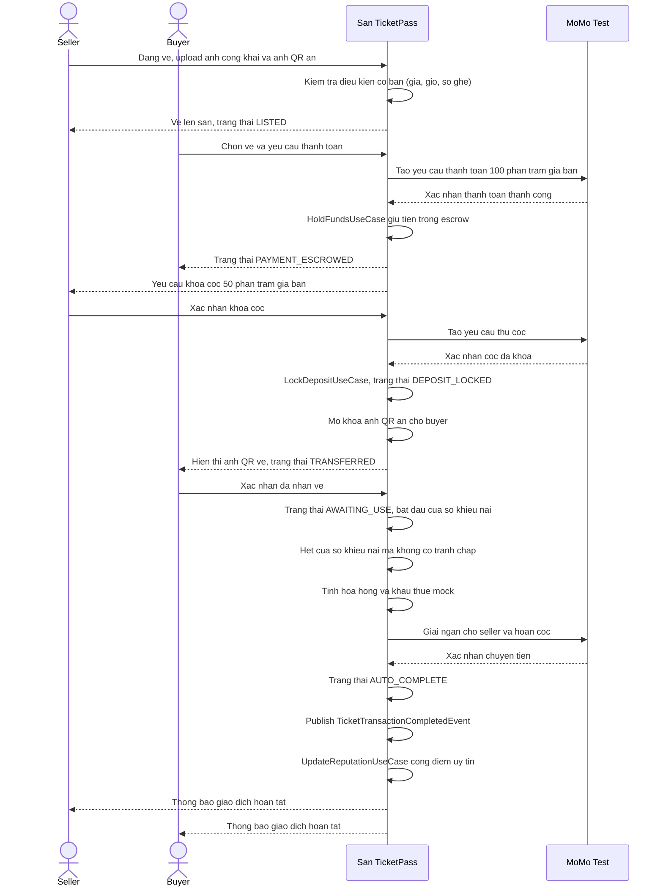

# Tổng quan dự án TicketPass

Tài liệu mở đầu, dành cho người mới tiếp cận dự án (thành viên nhóm, giảng viên hướng dẫn, hội đồng bảo vệ) muốn hiểu nhanh sản phẩm làm gì, giải quyết vấn đề gì và gồm những phần nào.

## 1. Mục tiêu đồ án

TicketPass là một web application viết bằng Java Spring Boot, đóng vai trò **sàn giao dịch vé điện tử** (marketplace kiểu Shopee nhưng chuyên bán vé) cho ba loại vé: vé xem phim, vé concert và vé xe khách.

Mục tiêu của đồ án gồm hai phần song song:

- **Mục tiêu nghiệp vụ:** xây dựng một sàn trung gian đủ tin cậy để người bán có thể đăng bán vé và người mua có thể mua vé mà không phải tin nhau, bằng cách kết hợp giữ tiền (escrow), cọc của người bán và cơ chế khiếu nại có thời hạn. Mô hình hoạt động giống các sàn thương mại điện tử: người bán đăng sản phẩm, người mua duyệt và mua, sàn đứng giữa bảo vệ cả hai bên.
- **Mục tiêu học thuật (môn OOP):** áp dụng đúng và có lý do các nguyên lý thiết kế hướng đối tượng — đóng gói, trừu tượng hoá qua interface, đa hình — cùng bốn design pattern trọng tâm: **Adapter**, **State**, **Strategy**, **Observer**. Mỗi pattern trong dự án phải giải quyết một vấn đề thật, không phải nhồi vào cho đủ số lượng.

## 2. Bài toán thực tế và vì sao cần sàn trung gian

Hiện nay, khi một người muốn bán lại vé đã mua (đổi kế hoạch, trùng lịch, ốm) hoặc muốn mua vé từ nguồn khác ngoài kênh chính thức, kênh phổ biến nhất là các hội nhóm trên Facebook và Zalo. Kênh này không có bất kỳ cơ chế bảo vệ nào: người mua phải chuyển tiền trước khi biết vé có thật hay không, và người bán không có gì ràng buộc sau khi nhận tiền.

Sàn trung gian giải quyết vấn đề này bằng hai cơ chế kinh tế:

- Tiền của người mua **không đến tay người bán ngay**, mà được sàn giữ trong escrow cho đến khi người mua xác nhận vé dùng được và hết thời hạn khiếu nại.
- Người bán phải **khoá cọc 50% giá bán** trước khi được chuyển vé. Nếu người bán gian và thua tranh chấp, cọc bị tịch thu để bồi thường người mua. Người bán gian không còn "mất không gì cả" mà mất tiền thật.
- Có **quy trình khiếu nại rõ ràng** với bằng chứng, thời hạn phản hồi và người phán quyết.

Ngoài ra, sàn cung cấp trải nghiệm mua sắm kiểu marketplace: người mua có thể **duyệt, tìm kiếm, lọc** vé theo loại (phim / xe khách / concert), xem ảnh thông tin vé công khai, đọc mô tả, kiểm tra uy tín người bán — tất cả ở một nơi thay vì phải lướt qua hàng trăm bài đăng rải rác trên mạng xã hội.

Sàn thu hoa hồng theo bậc giá vé để duy trì hoạt động, chia đôi giữa người mua và người bán.

## 3. Phạm vi TRONG đồ án

Những chức năng được hiện thực đầy đủ và có thể demo:

- **Quản lý người dùng:** đăng ký, đăng nhập (session-based), phân quyền theo vai, xem và cập nhật thông tin cá nhân.
- **Đăng vé bán:** người bán khai thông tin vé theo từng loại (xem chi tiết ở mục 6.1), upload ảnh công khai và ảnh QR ẩn, tuỳ chọn thêm mô tả.
- **Cơ chế ảnh hai lớp:** ảnh công khai (thông tin vé, để người mua xem trước khi mua) và ảnh QR ẩn (mã vé thật, chỉ được chuyển cho người mua sau khi sàn xác nhận đã giữ tiền trong escrow).
- **Thanh toán escrow:** người mua thanh toán 100% giá bán qua MoMo Test Environment, tiền vào escrow của sàn.
- **Cọc người bán:** khoá cọc 50% giá bán trước khi chuyển vé.
- **Chuyển vé theo loại:** mỗi loại vé có quy trình riêng, sau khi người bán khoá cọc, sàn tự động chuyển ảnh QR ẩn cho người mua.
- **Hoàn tất tự động:** hết cửa sổ khiếu nại mà không có tranh chấp thì hệ thống tính hoa hồng, khấu thuế (mock), giải ngân cho người bán, hoàn cọc.
- **Khiếu nại và phán quyết:** người mua nộp bằng chứng (ảnh, video), người bán phản hồi trong thời hạn, admin phán quyết, hệ thống thực thi hoàn tiền hoặc tịch thu cọc theo công thức đã chốt.
- **Điểm uy tín:** tự động cộng/trừ điểm sau mỗi giao dịch hoặc tranh chấp, cập nhật bất đồng bộ qua domain event.
- **Giao diện web:** các trang Thymeleaf cho toàn bộ luồng trên, gồm cả trang quản trị để xử lý tranh chấp.

## 4. Phạm vi NGOÀI đồ án

Những phần dưới đây **cố tình không làm**. Đây là quyết định phạm vi có chủ ý, không phải thiếu sót:

- **Thanh toán thật:** chỉ dùng MoMo Test Environment. Tích hợp cổng thanh toán thật đòi hỏi tài khoản doanh nghiệp, hợp đồng và kiểm định, nằm ngoài khả năng của một nhóm sinh viên.
- **KYC thật:** không xác minh giấy tờ tuỳ thân, không đối chiếu CCCD với cơ sở dữ liệu quốc gia. Người dùng chỉ cần email hợp lệ.
- **Thuế thật:** `TaxWithholdingService` là stub với tỷ lệ cấu hình được, không phản ánh quy định thuế thực tế của Việt Nam.
- **Ứng dụng mobile:** chỉ có web responsive, không có app iOS/Android.
- **Chat realtime giữa người mua và người bán:** trao đổi diễn ra qua kênh ngoài sàn; sàn chỉ ghi nhận bằng chứng khi có khiếu nại.
- **Tìm kiếm nâng cao / Elasticsearch:** chỉ có lọc và tìm kiếm cơ bản bằng truy vấn JPA trên MySQL. Không có full-text search, gợi ý, xếp hạng theo độ liên quan.
- **Thông báo đẩy, email marketing, hệ thống khuyến mãi.**
- **Xác thực vé tự động (OCR, hash QR, parse email forward):** đây là quyết định phạm vi có chủ ý — sàn tập trung vào mô hình marketplace với hai lớp bảo vệ kinh tế (cọc + escrow) thay vì xác thực kỹ thuật phức tạp.

## 5. Các vai trong hệ thống

Hệ thống chỉ có **hai vai kỹ thuật** trong enum `UserRole`:

| Vai (`UserRole`) | Quyền hạn chính |
|---|---|
| **`USER`** | Đăng vé bán, thanh toán mua vé, khoá cọc, xác nhận đã nhận vé, mở khiếu nại, phản hồi khiếu nại, xem lịch sử giao dịch và điểm uy tín của mình. |
| **`ADMIN`** | Toàn bộ quyền của `USER`, cộng thêm: phán quyết tranh chấp, xem báo cáo hoa hồng. Không được tự tay sửa trạng thái vé ngoài quy trình. |

"Người bán" (seller) và "người mua" (buyer) **không phải là vai của tài khoản** mà là **vị trí trong một giao dịch cụ thể**: người tạo listing là seller của giao dịch đó, người thanh toán vào escrow là buyer. Cùng một tài khoản `USER` có thể là seller của giao dịch này và buyer của giao dịch khác — giống như trên Shopee, một người vừa có thể mở shop bán hàng vừa có thể mua hàng từ shop khác. Quyết định này giữ cho `UserRole` đơn giản và tránh phải cấp/thu hồi vai mỗi khi người dùng đổi ý định sử dụng sàn.

Khách chưa đăng nhập (guest) không có bản ghi `User` nào; họ chỉ xem được danh sách vé đang bán và trang chi tiết vé công khai, mọi hành động khác đều bị `SecurityConfig` chặn và chuyển hướng về trang đăng nhập.

## 6. Luồng nghiệp vụ tổng quan

### 6.1 — Ba loại vé và thông tin đăng bán

Sàn hỗ trợ ba loại vé, mỗi loại có các trường thông tin riêng. Mọi loại vé đều có hai loại ảnh: **ảnh công khai** (thông tin vé để người mua xem trước) và **ảnh QR ẩn** (mã vé thật, chỉ chuyển cho buyer sau khi escrow xác nhận).

**Vé xem phim (`MOVIE`):**
- Tên phim (nhập chuẩn định dạng để hệ thống tự phân loại)
- Tên rạp (lựa chọn trong danh sách có sẵn)
- Giờ chiếu (nhập từng ô theo định dạng có sẵn: ngày/giờ/phút)
- Số lượng vé (số nguyên > 0)
- Ghế (số lượng ghế phải khớp đúng với số lượng vé)
- Giá bán (> 0)
- Ảnh công khai + Ảnh QR ẩn
- Mô tả (tuỳ chọn)

**Vé xe khách (`BUS`):**
- Hãng xe (lựa chọn trong danh sách có sẵn)
- Điểm xuất phát
- Điểm đến
- Giờ chạy
- Số lượng chỗ (số nguyên > 0)
- Tên ghế (số lượng chỗ phải khớp đúng với số ghế nhập vào)
- Giá bán (> 0)
- Ảnh công khai + Ảnh QR ẩn
- Mô tả (tuỳ chọn)

**Vé concert (`CONCERT`):**
- Tên concert (nhập chuẩn định dạng để hệ thống tự phân loại)
- Địa điểm
- Loại vé: chọn **Ngồi** hoặc **Đứng**
  - Nếu đứng → hiện ô nhập Line hoặc Zone
  - Nếu ngồi → hiện ô nhập Ghế hoặc Zone
- Giờ bắt đầu (nhập từng ô theo định dạng có sẵn)
- Số lượng vé (số nguyên > 0)
- Ghế/Zone (phải khớp với số lượng vé)
- Giá bán (> 0)
- Ảnh công khai + Ảnh QR ẩn
- Mô tả (tuỳ chọn)

### Bước 1 — Người bán đăng vé lên sàn

Người bán khai thông tin vé theo đúng loại (mục 6.1), upload ảnh công khai và ảnh QR ẩn. Hệ thống kiểm tra các điều kiện cơ bản: giá bán hợp lệ, giờ sự kiện ở tương lai, số ghế khớp với số lượng vé. Vé đạt điều kiện được lên sàn ngay với trạng thái `LISTED`.

### Bước 2 — Người mua thanh toán vào escrow

Người mua chọn vé và thanh toán **100% giá bán** qua MoMo Test Environment. Tiền không đến người bán mà được sàn giữ trong escrow. Vé chuyển sang trạng thái `PAYMENT_ESCROWED`. Tại bước này, người mua chỉ thấy ảnh công khai của vé, chưa thấy ảnh QR ẩn.

### Bước 3 — Người bán khoá cọc

Người bán khoá cọc bằng **50% giá bán**. Vé chuyển sang `DEPOSIT_LOCKED`. Cọc là đòn bẩy kinh tế cốt lõi: nó khiến việc lừa đảo trở nên bất lợi cho chính người bán, vì nếu thua tranh chấp thì cọc bị tịch thu.

### Bước 4 — Sàn chuyển ảnh QR ẩn cho người mua

Sau khi người bán đã khoá cọc, sàn tự động mở khoá ảnh QR ẩn cho người mua xem. Đây là lúc người mua lần đầu tiên thấy mã vé thật. Vé chuyển sang `TRANSFERRED`.

### Bước 5 — Người mua xác nhận đã nhận

Người mua xác nhận đã nhận được vé (đã xem được ảnh QR). Vé chuyển sang `AWAITING_USE` và **cửa sổ khiếu nại bắt đầu đếm**, độ dài tuỳ theo loại vé.

### Bước 6 — Hoàn tất tự động

Nếu hết cửa sổ khiếu nại mà không có tranh chấp nào được mở, hệ thống chuyển vé sang `AUTO_COMPLETE`: tính hoa hồng theo bậc giá vé, khấu thuế (mock), giải ngân phần còn lại cho người bán, hoàn cọc cho người bán, rồi publish `TicketTransactionCompletedEvent`. Module `reputation` lắng nghe event này và cộng điểm uy tín cho cả hai bên.

### Bước 7 — Khiếu nại và phán quyết

Nếu người mua mở khiếu nại trong cửa sổ, vé chuyển sang `DISPUTE_UNDER_REVIEW`. Người mua nộp bằng chứng, người bán phản hồi trong thời hạn quy định, admin xem xét và phán quyết:

- **Người mua thắng:** hoàn 100% escrow cho người mua và tịch thu cọc người bán theo công thức đã chốt (một phần là phí xử lý của sàn, phần còn lại bồi thường người mua). Vé chuyển sang `RESOLVED_BUYER_WINS`.
- **Người bán thắng:** giải ngân và hoàn cọc như trường hợp hoàn tất bình thường. Vé chuyển sang `RESOLVED_SELLER_WINS`.

### Sơ đồ luồng mua bán thành công

## 7. Hai lớp bảo vệ giao dịch

Hệ thống dựa vào hai lớp bảo vệ mang tính **kinh tế** để đảm bảo giao dịch an toàn cho cả hai bên. Đây là cách tiếp cận của các sàn thương mại điện tử lớn: thay vì cố gắng xác thực kỹ thuật từng sản phẩm, sàn tạo ra cấu trúc kinh tế khiến hành vi gian lận trở nên bất lợi.

### Lớp 1 — Cọc 50% của người bán

Người bán phải khoá cọc bằng 50% giá bán trước khi được chuyển vé.

**Tác dụng:** toàn bộ các kiểu gian lận mà kẻ gian tính "mất không gì cả" đều bị vô hiệu hoá. Trên hội nhóm Facebook, kẻ gian chỉ mất một tài khoản ảo. Trên sàn này, nếu thua tranh chấp thì cọc bị tịch thu, nên hành vi lừa đảo trở thành lỗ. Đây là lớp bảo vệ mang tính **kinh tế** — nó tác động vào động cơ lừa đảo chứ không chỉ chặn hành vi.

### Lớp 2 — Escrow kết hợp khiếu nại có cửa sổ thời gian

Tiền của người mua được sàn giữ trong escrow và chỉ giải ngân sau khi hết cửa sổ khiếu nại. Trong cửa sổ đó, người mua có quyền mở tranh chấp kèm bằng chứng.

**Tác dụng:** nhận tiền rồi biến mất là không thể, vì tiền chưa từng đến tay người bán. Vé có vấn đề thì người mua phát hiện và mở khiếu nại kịp thời, escrow được hoàn 100%. Cửa sổ khiếu nại có độ dài khác nhau theo loại vé và luôn kết thúc trước giờ sự kiện/khởi hành.

### Cơ chế ảnh hai lớp

Bổ sung cho hai lớp bảo vệ kinh tế, sàn còn có cơ chế **ảnh hai lớp**: ảnh công khai (thông tin vé, cho buyer xem trước khi quyết định mua) và ảnh QR ẩn (mã vé thật, chỉ mở khoá sau khi sàn đã giữ tiền trong escrow và seller đã khoá cọc). Nhờ vậy, người bán không thể lấy lại mã vé sau khi đã bán, và người mua không thấy mã vé trước khi trả tiền.

## 8. Tech stack

| Thành phần | Công nghệ | Vai trò trong dự án |
|---|---|---|
| Ngôn ngữ | Java 17 | Record, sealed class, pattern matching cho switch giúp mã domain gọn hơn |
| Framework | Spring Boot 3.3.x | Dependency injection, auto-configuration, quản lý transaction |
| Build tool | Maven, kèm Maven Wrapper (`mvnw`) | Cả nhóm build với đúng một phiên bản Maven, không phụ thuộc cài đặt máy cá nhân |
| Cơ sở dữ liệu | MySQL 8 | Cơ sở dữ liệu chính khi chạy thật |
| Cơ sở dữ liệu test | H2 in-memory | Test chạy nhanh, không cần cài MySQL trên máy chấm bài |
| ORM | Spring Data JPA, Hibernate | Mapping entity, repository tự sinh |
| Migration | Flyway | Lược đồ cơ sở dữ liệu được version hoá, ba người không ghi đè lược đồ của nhau |
| Web layer | Spring Web MVC, Thymeleaf | Server-side rendering, không cần dựng frontend riêng |
| Bảo mật | Spring Security (session-based) | Đăng nhập, phân quyền theo vai |
| Thanh toán | MoMo Test Environment | Sandbox thanh toán, không cần tài khoản doanh nghiệp; ẩn sau interface `PaymentGateway` |

## 9. Phân công nhóm

Nhóm gồm ba người. Việc chia theo **module nghiệp vụ** thay vì chia theo layer kỹ thuật khiến mỗi người sở hữu trọn một vài thư mục, nhờ đó xung đột git gần như bằng không.

| Người | Modules phụ trách | Pattern trọng tâm | Vai trò |
|---|---|---|---|
| **A** | `ticket`, `web` (giao diện toàn sàn) | Adapter, State, Strategy | Vòng đời vé, 3 adapter loại vé (phim, xe khách, concert), state machine, validation đăng vé, toàn bộ giao diện Thymeleaf, layout và styling CSS |
| **B** | `payment`, `dispute` | Adapter, Strategy | Dòng tiền và xử lý tranh chấp: escrow, cọc, hoa hồng, thuế, giải ngân, hoàn tiền, tịch thu cọc, quy trình khiếu nại |
| **C** | `user`, `reputation`, `shared` (backend) | Observer, Adapter | Người dùng và xác thực đăng nhập, điểm uy tín qua domain event, backend xử lý người dùng và toàn bộ hạ tầng dùng chung: lưu file, cấu hình, xử lý ngoại lệ |

> **Ghi chú:** Module `verification` (OCR, hash QR, email forward, phân bậc rủi ro) đã được **deprecated** khi dự án chuyển hướng sang mô hình marketplace. Xem phần giải thích ở mục 4 — Phạm vi NGOÀI đồ án.

## 10. Đọc tiếp

| Tài liệu | Nội dung |
|---|---|
| [01-kien-truc-he-thong.md](01-kien-truc-he-thong.md) | Kiểu kiến trúc, cây package, quy tắc phụ thuộc giữa các layer và module, bốn nguyên tắc scalability bắt buộc, và danh sách nợ kỹ thuật đã biết. |
| [04-quy-tac-nghiep-vu.md](04-quy-tac-nghiep-vu.md) | Toàn bộ quy tắc nghiệp vụ: bảng hoa hồng, phí tối thiểu, cọc, công thức tịch thu, thuế, cửa sổ khiếu nại, điểm uy tín, điều kiện đăng vé. |
| [05-state-machine-giao-dich.md](05-state-machine-giao-dich.md) | Chín trạng thái của vé, sơ đồ chuyển đổi, ma trận chuyển đổi hợp lệ, các bất biến của hệ thống và ai gọi gì ở mỗi bước chuyển. |
| [06-quy-uoc-code-va-git.md](06-quy-uoc-code-va-git.md) | Quy ước đặt tên, coding convention, quy trình nhánh và commit để ba người làm song song không xung đột. |
| [07-phan-cong-cong-viec.md](07-phan-cong-cong-viec.md) | Phân chia module cho từng thành viên, danh sách công việc và mốc thời gian. |
| [08-ke-hoach-tich-hop.md](08-ke-hoach-tich-hop.md) | Thứ tự ghép các module, các mốc tích hợp và cách kiểm tra luồng đầu-cuối. |
| [09-oop-design-patterns.md](09-oop-design-patterns.md) | Bốn pattern trọng tâm Adapter, State, Strategy, Observer: mỗi pattern giải quyết vấn đề gì trong dự án, hiện thực ở class nào. |
