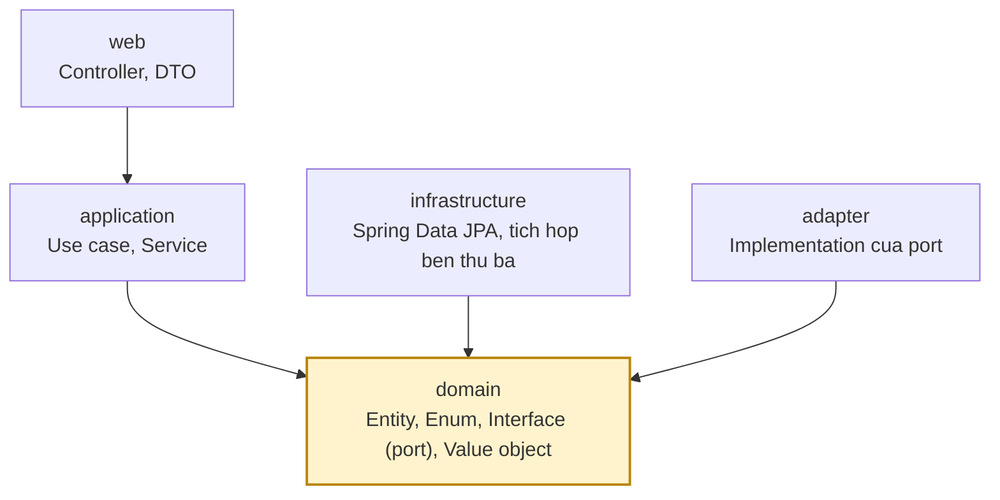
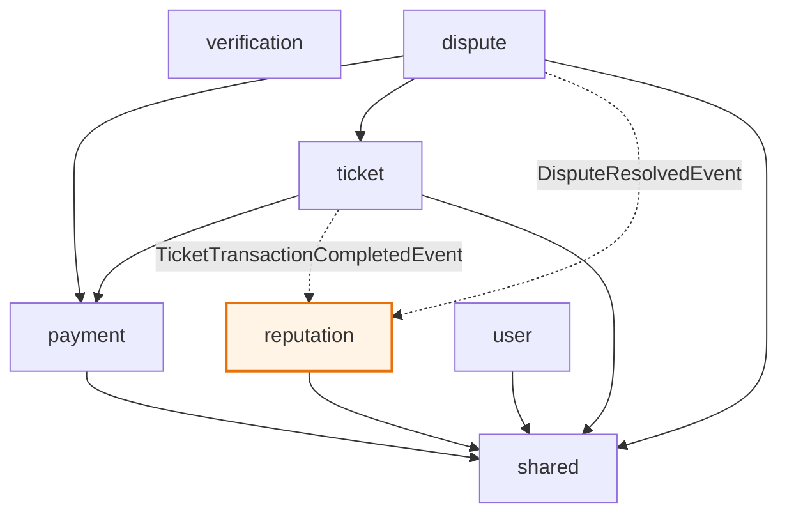

# Kiến trúc hệ thống TicketPass

Tài liệu mô tả cách mã nguồn được tổ chức: kiểu kiến trúc, cây package đầy đủ, chiều phụ thuộc giữa các layer, quy tắc giao tiếp giữa các module và bốn nguyên tắc scalability bắt buộc mà cả ba thành viên phải tuân thủ khi viết code.

## 1. Kiểu kiến trúc: modular monolith phân layer

TicketPass được xây dựng như một **modular monolith**: một tiến trình Spring Boot duy nhất, một cơ sở dữ liệu duy nhất, nhưng bên trong được chia thành các module nghiệp vụ độc lập với ranh giới rõ ràng.

Lý do chọn modular monolith thay vì microservices:

- **Quy mô nhóm:** ba sinh viên. Microservices đòi hỏi service discovery, distributed transaction, API gateway, message broker, và ít nhất ba pipeline triển khai. Chi phí vận hành lớn hơn nhiều lần giá trị học thuật thu được.
- **Tính nhất quán của tiền:** escrow, cọc, hoa hồng và giải ngân phải nằm trong **cùng một transaction ACID**. Nếu tách thành service riêng, phải hiện thực saga hoặc two-phase commit — rất dễ sai và không phải trọng tâm môn OOP.
- **Vẫn giữ đường tách:** các module giao tiếp qua ID thuần và domain event chứ không qua JPA relation, nên nếu sau này muốn tách một module ra service riêng thì đường cắt đã có sẵn (xem [Nguyên tắc 1](#nguyên-tắc-1--không-dùng-jpa-relation-xuyên-module)).

### Vì sao chia thư mục cấp một theo domain thay vì theo layer

Thư mục cấp một là **module nghiệp vụ** (`ticket/`, `payment/`, `dispute/`...), không phải layer kỹ thuật (`controllers/`, `services/`, `repositories/`, `entities/`). Layer vẫn còn nguyên, chỉ nằm ở cấp hai bên trong mỗi module.

**Lý do chính: ba người làm ba vùng nghiệp vụ khác nhau, chia theo domain thì mỗi người sở hữu trọn một thư mục và xung đột git gần như bằng không.** Nếu chia theo layer, cả ba người sẽ đồng thời sửa `services/`, `controllers/`, `repositories/`; mọi commit đều chạm vào cùng vài thư mục, mỗi lần `git pull` là một lần hoà giải conflict, và không ai biết chắc file nào là của mình.

Ba lý do phụ:

1. **Tính gắn kết cao hơn.** Muốn hiểu nghiệp vụ thanh toán, mở đúng một thư mục `payment/` là thấy đủ entity, use case, gateway adapter, repository và controller — không phải nhảy qua bốn thư mục để ghép lại một luồng.
2. **Ranh giới module hiện rõ trong code.** Khi entity và repository của `payment` nằm gọn trong `payment/`, việc một class ở `ticket/` import `payment.domain.EscrowTransaction` trở thành hành động nhìn thấy được ngay ở dòng import, dễ phát hiện khi review. Nếu tất cả entity nằm chung trong `entities/`, mọi import đều trông giống nhau và ranh giới biến mất.
3. **Đường tiến hoá về sau.** Nếu cần tách một module ra service riêng, thư mục module chính là đơn vị để cắt.

Đánh đổi phải chấp nhận: cấu trúc lồng sâu hơn một cấp, và người mới đọc code phải làm quen với quy ước "mỗi module có bốn đến năm layer con" trước khi tìm được class.

Bên trong mỗi module, mã được chia theo bốn đến năm layer cố định: `domain`, `adapter`, `application`, `infrastructure`, `web`. Đây là biến thể rút gọn của **hexagonal architecture (ports & adapters)**: `domain` khai báo *port* dưới dạng interface, `adapter` và `infrastructure` cung cấp *implementation*, `application` điều phối, `web` chỉ là cổng vào HTTP.

## 2. Cây package

```
com.yourapp.ticketpass
 ├── ticket
 │    ├── domain          Ticket, TicketType, TicketStatus, TicketAdapter (interface),
 │    │                   TicketRepository (interface), ValidationResult, TransferInstruction,
 │    │                   IllegalTicketTransitionException
 │    ├── adapter         MovieTicketAdapter, ConcertTicketAdapter, TrainTicketAdapter, BusTicketAdapter
 │    ├── application     TransferTicketService, ValidateTicketService, TicketStateMachineService
 │    ├── infrastructure  TicketJpaRepository, TicketRepositoryImpl
 │    └── web             TicketController, dto/
 ├── verification [DEPRECATED]
 │    ├── (Toan bo module nay da bi deprecated do du an chuyen sang mo hinh marketplace)
 ├── payment
 │    ├── domain          EscrowTransaction, Deposit, EscrowStatus, DepositStatus, CommissionTier,
 │    │                   PaymentGateway (interface), PaymentRequest, PaymentResult,
 │    │                   EscrowTransactionRepository (interface), DepositRepository (interface)
 │    ├── adapter         MomoTestGatewayAdapter
 │    ├── application     HoldFundsUseCase, LockDepositUseCase, CommissionCalculatorService,
 │    │                   TaxWithholdingService, ReleaseFundsUseCase, ForfeitDepositPolicy, RefundBuyerUseCase
 │    ├── infrastructure  EscrowTransactionJpaRepository, DepositJpaRepository, *RepositoryImpl
 │    └── web             PaymentController, dto/
 ├── dispute
 │    ├── domain          Dispute, DisputeEvidence, DisputeStatus, DisputeReason, DisputeEvidenceType,
 │    │                   DisputeWindowPolicy (interface), DisputeRepository, DisputeEvidenceRepository
 │    ├── application     FileDisputeUseCase, RespondToDisputeUseCase, ReviewDisputeUseCase, AutoCompleteScheduler
 │    ├── infrastructure  DisputeJpaRepository, DisputeEvidenceJpaRepository, *RepositoryImpl
 │    └── web             DisputeController, admin/DisputeReviewController, dto/
 ├── reputation
 │    ├── domain          UserReputationScore, ReputationRepository (interface)
 │    ├── application     UpdateReputationUseCase (lắng nghe domain event)
 │    ├── infrastructure  ReputationJpaRepository, ReputationRepositoryImpl
 │    └── web             ReputationController, dto/
 ├── user
 │    ├── domain          User, UserRole, UserStatus, UserRepository (interface)
 │    ├── application     RegisterUserUseCase, UserProfileService, UserQueryService
 │    ├── infrastructure  UserJpaRepository, UserRepositoryImpl, UserDetailsServiceImpl
 │    └── web             UserController, HomeController, dto/
 └── shared
      ├── storage/        FileStorageService (interface), StoredFileRef, FileStorageException,
      │                   adapter/LocalFileStorageAdapter
      ├── event/          TicketTransactionCompletedEvent, CompletionReason,
      │                   DisputeResolvedEvent, DisputeOutcome
      ├── dto/            CommissionBreakdown, TaxWithholding, ForfeitBreakdown
      ├── config/         SecurityConfig, OcrConfig, PaymentGatewayConfig, CommissionConfig, TaxConfig
      ├── exception/      GlobalExceptionHandler, BusinessRuleViolationException, ResourceNotFoundException
      └── util/           QrCodeGenerator, ImageHashUtil
```

Bảy module nghiệp vụ (`ticket`, `verification`, `payment`, `dispute`, `reputation`, `user`) cộng với một module hạ tầng dùng chung (`shared`). Không có package "utils" toàn cục chứa mọi thứ: mỗi helper phải thuộc về một module có ý nghĩa nghiệp vụ, riêng `shared` chỉ chứa những thứ **thực sự** được ít nhất hai module dùng chung.

## 3. Chiều phụ thuộc giữa các layer

Chiều phụ thuộc bắt buộc:

```
web → application → domain ← infrastructure
                      ↑
                   adapter
```



Điểm mấu chốt: **mũi tên luôn hướng vào `domain`**. `domain` là tâm và không phụ thuộc vào bất cứ layer nào khác.

| Layer | Được phép chứa | Bị cấm | Phụ thuộc được phép |
|---|---|---|---|
| `domain` | Entity JPA, enum, value object, interface (port), exception nghiệp vụ | Spring Data (`JpaRepository`), Spring Web (`@Controller`, `HttpServletRequest`), gọi HTTP, đọc/ghi file | Chỉ JDK, `jakarta.persistence`, `jakarta.validation`, Lombok |
| `adapter` | Các biến thể implement interface của `domain` | Truy cập cơ sở dữ liệu trực tiếp, chứa quy tắc điều phối nhiều bước | `domain` cùng module hoặc `shared` |
| `application` | Use case, service điều phối, ranh giới `@Transactional`, publish event | Annotation của web (`@RequestMapping`), thao tác `HttpSession` trực tiếp, `new File(...)` | `domain` cùng module, `shared`, interface của module khác khi cần đồng bộ |
| `infrastructure` | `interface XxxJpaRepository extends JpaRepository`, `XxxRepositoryImpl` delegate, tích hợp Tesseract | Chứa quy tắc nghiệp vụ, tính toán tiền | `domain` cùng module, thư viện bên thứ ba |
| `web` | `@Controller`, DTO request/response, mapping DTO ↔ tham số use case | Bất kỳ logic nghiệp vụ nào, trả entity thẳng ra Thymeleaf, gọi repository trực tiếp | `application` cùng module, DTO của `shared` |

Một vài giải thích cụ thể để tránh hiểu sai:

**`domain` không phụ thuộc Spring Data.** `TicketRepository` là interface *do chúng ta tự khai báo* trong `ticket.domain`, chỉ có đúng những phương thức nghiệp vụ cần (`save`, `findById`, `findAllListed`, `findByQrHash`). Nó không kế thừa `JpaRepository`. Bên `ticket.infrastructure` mới có `TicketJpaRepository extends JpaRepository<Ticket, Long>` và `TicketRepositoryImpl implements TicketRepository` chỉ việc gọi xuống. Nhờ vậy, khi viết unit test cho `TransferTicketService`, ta cài một `TicketRepository` giả bằng `HashMap` mà không cần khởi động Spring context.

**`web` là lớp mỏng.** Controller chỉ làm ba việc: nhận request và validate định dạng, gọi đúng một use case, đóng gói kết quả thành DTO cho view. Nếu một controller method dài quá khoảng 15 dòng hoặc có `if` liên quan tới nghiệp vụ, đó là dấu hiệu logic đã lọt sai chỗ và phải kéo xuống `application`.

**Không trả entity ra view.** `Ticket` chứa `qrPayloadHash`, `perceptualHash`, `originalPrice`, thông tin nội bộ của người bán. Ném thẳng entity vào Thymeleaf sẽ rò rỉ dữ liệu và khiến mọi thay đổi trong entity làm vỡ template. Luôn đi qua `TicketResponse` / `TicketSummaryResponse`.

**`adapter` khác `infrastructure` ở chỗ nào.** `infrastructure` là hạ tầng kỹ thuật bắt buộc phải có (JPA, Tesseract). `adapter` là **các biến thể thay thế được của cùng một khái niệm nghiệp vụ**: bốn `TicketAdapter` cho bốn loại vé, `MomoTestGatewayAdapter` cho `PaymentGateway`, `LocalFileStorageAdapter` cho `FileStorageService`. Nếu mai này thêm `VnPayGatewayAdapter` hay `S3FileStorageAdapter` thì đó là thêm file mới vào `adapter`, không sửa gì trong `application`.

## 4. Quy tắc giao tiếp giữa các module

| Loại tương tác | Cách làm | Ví dụ |
|---|---|---|
| Tham chiếu dữ liệu | Lưu ID thuần, không JPA relation | `Dispute.ticketId`, `EscrowTransaction.buyerId` |
| Side-effect không thuộc dòng tiền | `ApplicationEventPublisher` + `@TransactionalEventListener(AFTER_COMMIT)` | `dispute` publish `TicketTransactionCompletedEvent`, `reputation` lắng nghe và cộng điểm |
| Thao tác dòng tiền | Gọi trực tiếp use case của `payment`, đồng bộ, cùng transaction | `AutoCompleteScheduler` gọi `ReleaseFundsUseCase.release(...)` |
| Đổi trạng thái vé | Chỉ qua `TicketStateMachineService` | `FileDisputeUseCase` gọi `stateMachine.transition(ticketId, DISPUTE_UNDER_REVIEW)` |
| Đọc dữ liệu module khác | Qua interface repository hoặc query service của module đó, không bao giờ qua `*JpaRepository` | `FileDisputeUseCase` đọc loại vé và `eventStartAt` qua `TicketRepository` để tính cửa sổ khiếu nại |

Không module nào được `@Autowired` một `*JpaRepository` của module khác. Nếu cần dữ liệu, đi qua interface trong `domain` của module sở hữu dữ liệu đó.

### 4.1 Sơ đồ quan hệ giữa các module

Mũi tên **liền** là gọi trực tiếp, đồng bộ, trong cùng transaction. Mũi tên **nét đứt** là truyền tin qua domain event, chạy sau commit.



Diễn giải sơ đồ:

- `ticket` gọi trực tiếp các use case tiền của `payment`, vì phải biết ngay tiền đã vào escrow hay chưa. (Module `verification` truoc day duoc goi de xac thuc, nay da bi deprecated).
- `dispute` gọi trực tiếp `payment` để hoàn tiền và tịch thu cọc, và gọi `ticket` (qua `TicketStateMachineService`) để đổi trạng thái vé sau phán quyết.
- `reputation` **chỉ nghe event**, không ai gọi nó trực tiếp. Nhờ vậy, nếu module uy tín lỗi thì giao dịch tiền vẫn hoàn tất đúng.
- `user` không gọi module nào. Các module khác chỉ tham chiếu người dùng bằng `Long userId`; khi cần hiển thị tên thì tầng `web` truy vấn `UserQueryService`.
- `shared` là điểm phụ thuộc chung của tất cả và **không được phụ thuộc vào module nghiệp vụ nào**. Nếu `shared` import `ticket.domain.Ticket` thì sẽ tạo phụ thuộc vòng.

Không có mũi tên nào tạo thành vòng. Đây là điều kiện để mỗi module viết được unit test độc lập.

### 4.2 Ma trận import giữa các module

Ký hiệu: **OK** được phép import; **EVT** chỉ được nhận thông tin qua domain event, không import trực tiếp; **KO** không được import.

| Module gọi \ Module bị gọi | ticket | verification | payment | dispute | reputation | user | shared |
|---|---|---|---|---|---|---|---|
| **ticket** | — | OK | OK (chỉ use case tiền) | KO | EVT | KO | OK |
| **verification** | KO | — | KO | KO | EVT | KO | OK |
| **payment** | KO | KO | — | KO | KO | KO | OK |
| **dispute** | OK (chỉ `TicketStateMachineService` và `TicketRepository`) | KO | OK (chỉ use case tiền) | — | EVT | KO | OK |
| **reputation** | KO | KO | KO | KO | — | KO | OK |
| **user** | KO | KO | KO | KO | KO | — | OK |
| **shared** | KO | KO | KO | KO | KO | KO | — |

Giải thích các ô dễ gây tranh luận:

- **`payment` không import module nào.** Đây là quy tắc cứng nhất. `payment` chỉ nhận vào ID cùng số tiền, và trả ra `PaymentResult` cùng các breakdown trong `shared.dto`. Nhờ đó module tiền kiểm thử được hoàn toàn độc lập và không bao giờ là nguyên nhân của phụ thuộc vòng.
- **Module `verification` đã bị deprecated.** Các quy tắc về import của nó được bỏ qua.
- **`dispute` được import `ticket` một cách hạn chế**, chỉ hai thứ: `TicketStateMachineService` để đổi trạng thái sau phán quyết, và `TicketRepository` để đọc loại vé cùng `eventStartAt` phục vụ tính cửa sổ khiếu nại. Không được import entity `Ticket` vào entity `Dispute`.
- **`shared` không import gì.** Nếu một class trong `shared` cần biết về `Ticket` thì class đó không thuộc `shared`.

Ma trận này không được kiểm tra tự động bằng ArchUnit trong phạm vi đồ án; việc tuân thủ dựa vào code review giữa ba thành viên. Đây là lựa chọn phạm vi có ý thức, và cách khắc phục được ghi ở mục nợ kỹ thuật.

## 5. Bốn nguyên tắc scalability bắt buộc

Đây là phần quan trọng nhất của tài liệu này. Bốn nguyên tắc dưới đây không phải gợi ý — chúng là điều kiện để ba người code song song mà không giẫm chân nhau, và là những gì cần trình bày khi bảo vệ đồ án.

### Nguyên tắc 1 — Không dùng JPA relation xuyên module

**Nguyên tắc là gì.** Không dùng `@ManyToOne`, `@OneToMany`, `@OneToOne`, `@JoinColumn` để nối entity của module này với entity của module khác. Mọi tham chiếu chỉ là ID thuần kiểu `Long`.

**Tại sao.** Ba lý do, xếp theo mức độ nghiêm trọng đối với dự án này:

1. *Xung đột khi ba người code song song.* Nếu `Dispute` giữ `@ManyToOne Ticket ticket`, thì module `dispute` phải compile được cùng module `ticket`. Bạn B đang sửa `Dispute` và bạn A đang đổi field trong `Ticket` sẽ làm hỏng build của nhau, và mỗi lần `git merge` là một lần phải hoà giải thủ công. Với ID thuần, hai module chỉ chia sẻ một con số `Long` — hợp đồng ổn định nhất có thể.
2. *Truy vấn ngầm khó kiểm soát.* Lazy-loading xuyên module tạo ra câu SELECT ở nơi không ai ngờ tới, dẫn tới N+1 query và `LazyInitializationException` khi entity đã ra khỏi transaction (điển hình là lúc render Thymeleaf).
3. *Không tách được về sau.* Foreign key ở tầng ORM khoá chặt hai bảng vào cùng một cơ sở dữ liệu. Muốn tách `payment` thành service riêng thì phải gỡ hết relation trước — công việc lớn hơn nhiều so với việc viết đúng ngay từ đầu.

**Hệ quả nếu vi phạm.** Build gãy chéo giữa các nhánh; merge conflict lặp lại ở chính các entity đông người sửa nhất; `LazyInitializationException` xuất hiện ngẫu nhiên trên trang chi tiết vé; và cây phụ thuộc giữa các module trở thành đồ thị vòng, khiến không thể viết unit test cho một module mà không kéo theo cả ứng dụng.

**Ví dụ code.**

```java
// SAI — dispute bị khoá chặt vào ticket
@Entity
public class Dispute {
    @Id @GeneratedValue
    private Long id;

    @ManyToOne(fetch = FetchType.LAZY)
    @JoinColumn(name = "ticket_id")
    private Ticket ticket;          // kéo cả module ticket vào dispute
}
```

```java
// ĐÚNG — chỉ giữ ID
@Entity
public class Dispute {
    @Id @GeneratedValue
    private Long id;

    @Column(name = "ticket_id", nullable = false)
    private Long ticketId;          // hợp đồng duy nhất giữa hai module là một con số

    @Column(name = "buyer_id", nullable = false)
    private Long buyerId;
}
```

Khi cần dữ liệu vé bên trong use case của `dispute`, nạp tường minh:

```java
@Service
@RequiredArgsConstructor
public class FileDisputeUseCase {
    private final DisputeRepository disputeRepository;
    private final TicketRepository ticketRepository;   // interface trong ticket.domain

    @Transactional
    public Long file(Long ticketId, Long buyerId, DisputeReason reason) {
        Ticket ticket = ticketRepository.findById(ticketId)
                .orElseThrow(() -> new ResourceNotFoundException("Không tìm thấy vé " + ticketId));
        // ... kiểm tra cửa sổ khiếu nại rồi tạo Dispute
    }
}
```

Cách này dài hơn một dòng nhưng làm cho **mọi truy vấn đều hiện rõ trong code**, không có SELECT nào chạy sau lưng.

**Quy ước bổ sung của dự án:** áp dụng ID thuần **cả trong cùng một module** để nhất quán — `DisputeEvidence` giữ `Long disputeId` chứ không phải `@ManyToOne Dispute`. Ba người không phải nhớ "trường hợp nào được dùng relation", chỉ cần nhớ một luật duy nhất: không bao giờ.

### Nguyên tắc 2 — Side-effect đi qua domain event, trừ phần tiền

**Nguyên tắc là gì.** Khi một use case hoàn thành và cần kích hoạt hệ quả ở module khác (cập nhật điểm uy tín, gửi thông báo, ghi nhật ký thống kê), **không gọi trực tiếp** service của module đó mà publish một domain event qua `ApplicationEventPublisher`; module quan tâm lắng nghe bằng `@TransactionalEventListener`. Đây chính là **Observer pattern** trong dự án.

**Ngoại lệ đã chốt:** mọi thao tác dòng tiền — `HoldFundsUseCase`, `LockDepositUseCase`, `ReleaseFundsUseCase`, `RefundBuyerUseCase` — **vẫn gọi trực tiếp, đồng bộ, trong cùng một transaction**, không qua event.

**Tại sao.** Với side-effect thông thường, event giúp module phát sự kiện không cần biết ai đang nghe: `dispute` không import `reputation`, muốn thêm module thống kê chỉ cần viết thêm một listener mà không sửa dòng nào ở `dispute`. Nó cũng cắt được phụ thuộc vòng — nếu `dispute` gọi thẳng `reputation` và `reputation` cần đọc dữ liệu tranh chấp thì hai module tham chiếu lẫn nhau.

Nhưng tiền thì khác. Giải ngân cho người bán và hoàn cọc phải hoặc **cùng thành công, hoặc cùng thất bại** với việc đổi trạng thái vé sang `AUTO_COMPLETE`. Nếu đẩy giải ngân sang listener `AFTER_COMMIT`, sẽ có một khoảnh khắc mà vé đã `AUTO_COMPLETE` nhưng tiền chưa chuyển; nếu listener ném exception, transaction gốc **đã commit rồi và không rollback được nữa**, để lại giao dịch hỏng mà không có cách tự sửa. Điểm uy tín lệch 2 điểm thì có thể tính lại; tiền mất thì không.

**Hệ quả nếu vi phạm.**

- Vi phạm chiều "event": `dispute` phải import `reputation` → phụ thuộc vòng, không unit test riêng module được, và mỗi lần thêm hệ quả mới lại phải sửa use case cũ (vi phạm Open/Closed).
- Vi phạm chiều "tiền phải đồng bộ": trạng thái vé và trạng thái tiền lệch nhau, không rollback được, phải sửa tay trong cơ sở dữ liệu.

**Ví dụ code.**

```java
// Side-effect KHÔNG thuộc dòng tiền → dùng event
@Service
@RequiredArgsConstructor
public class AutoCompleteScheduler {
    private final TicketStateMachineService stateMachine;
    private final ReleaseFundsUseCase releaseFundsUseCase;      // tiền: gọi trực tiếp
    private final ApplicationEventPublisher events;

    @Transactional
    public void complete(Long ticketId) {
        Ticket ticket = stateMachine.transition(ticketId, TicketStatus.AUTO_COMPLETE);

        // Đồng bộ, cùng transaction: nếu giải ngân lỗi thì transition cũng rollback
        releaseFundsUseCase.release(ticketId);

        // Bất đồng bộ, sau commit: uy tín lệch một chút không phá vỡ giao dịch
        events.publishEvent(new TicketTransactionCompletedEvent(
                ticketId, ticket.getSellerId(), ticket.getBuyerId(), CompletionReason.AUTO_COMPLETE));
    }
}
```

```java
@Component
@RequiredArgsConstructor
public class UpdateReputationUseCase {
    private final ReputationRepository reputationRepository;

    @TransactionalEventListener(phase = TransactionPhase.AFTER_COMMIT)
    public void on(TicketTransactionCompletedEvent event) {
        reputationRepository.adjust(event.sellerId(), +2);
        reputationRepository.adjust(event.buyerId(), +2);
    }
}
```

Lưu ý `AFTER_COMMIT`: listener chỉ chạy khi transaction gốc đã commit thành công. Nếu giải ngân thất bại và transaction rollback thì event **không** được phát, nên không có chuyện cộng điểm uy tín cho một giao dịch chưa hoàn tất.

### Nguyên tắc 3 — Mọi thao tác file đi qua `FileStorageService`

**Nguyên tắc là gì.** Ảnh vé, ảnh QR, ảnh và video bằng chứng khiếu nại đều được lưu qua interface `shared.storage.FileStorageService`. Giai đoạn học dùng `LocalFileStorageAdapter` ghi xuống thư mục `./data/uploads`. **Không có dòng business logic nào được gọi `new File(...)`, `Files.write(...)`, `FileOutputStream` hay `Paths.get(...)` trực tiếp.**

**Tại sao.** Nơi lưu file là chi tiết hạ tầng dễ thay đổi nhất trong toàn hệ thống: máy cá nhân lưu ổ đĩa, deploy lên server dùng volume, scale ngang phải dùng S3 hoặc MinIO vì nhiều instance không chia sẻ được ổ đĩa cục bộ. Nếu đường dẫn nằm rải rác trong use case, mỗi lần đổi là một lần sửa hàng chục file và bỏ sót ở đâu đó. Ngoài ra, viết test cho `TransferTicketService` sẽ phải thật sự tạo file trên ổ đĩa và dọn dẹp sau đó — chậm và dễ để lại rác.

**Hệ quả nếu vi phạm.** Ứng dụng chỉ chạy được trên đúng một máy có đúng cấu trúc thư mục đó; test phụ thuộc hệ thống file nên chạy trên máy giảng viên có thể fail; và khi chạy hai instance sau load balancer, ảnh upload lên instance A không đọc được từ instance B.

**Ví dụ code.**

```java
// shared/storage/FileStorageService.java
public interface FileStorageService {
    StoredFileRef store(byte[] content, String originalFilename, String folder) throws FileStorageException;
    byte[] read(StoredFileRef ref) throws FileStorageException;
    void delete(StoredFileRef ref) throws FileStorageException;
}
```

```java
// SAI — business logic biết đường dẫn vật lý
public class TransferTicketService {
    public void createListing(MultipartFile image) throws IOException {
        Path path = Paths.get("D:/uploads/tickets/" + image.getOriginalFilename());
        Files.write(path, image.getBytes());      // dính chặt vào ổ đĩa và vào máy của một người
    }
}
```

```java
// ĐÚNG — chỉ biết interface
@Service
@RequiredArgsConstructor
public class TransferTicketService {
    private final FileStorageService fileStorage;

    public void createListing(byte[] image, String filename) {
        StoredFileRef ref = fileStorage.store(image, filename, "tickets");
        // luu ref vao database
    }
}
```

Đổi sang S3 chỉ là thêm `S3FileStorageAdapter implements FileStorageService` và đổi một dòng `@Bean` trong config. `TransferTicketService` không sửa một ký tự nào.

### Nguyên tắc 4 — Session mặc định của Spring Security là đủ, nhưng phải biết giới hạn

**Nguyên tắc là gì.** Xác thực dùng **session-based** mặc định của Spring Security: đăng nhập thành công thì Spring tạo `HttpSession` phía server và trả `JSESSIONID` cho trình duyệt. Không tự hiện thực JWT, không tự viết filter xác thực.

**Tại sao chọn cách này cho đồ án.** Ứng dụng render server-side bằng Thymeleaf nên trình duyệt tự gửi cookie, không cần lưu token ở `localStorage` và không cần xử lý refresh token. Spring Security đã lo sẵn CSRF cho form, `remember-me`, đăng xuất, và cố định session. Tổng chi phí gần bằng không: cấu hình gọn trong `SecurityConfig`, phần còn lại là `UserDetailsServiceImpl` đọc `User` từ cơ sở dữ liệu.

```java
// shared/config/SecurityConfig.java
@Bean
SecurityFilterChain filterChain(HttpSecurity http) throws Exception {
    return http
        .authorizeHttpRequests(auth -> auth
            .requestMatchers("/", "/tickets", "/tickets/*", "/register", "/login", "/css/**").permitAll()
            .requestMatchers("/admin/**").hasRole("ADMIN")
            .anyRequest().authenticated())
        .formLogin(form -> form.loginPage("/login").defaultSuccessUrl("/", true))
        .logout(logout -> logout.logoutSuccessUrl("/"))
        .build();
}
```

**Giới hạn phải ghi rõ.** Session mặc định nằm **trong bộ nhớ của đúng một instance ứng dụng**. Hệ quả trực tiếp:

- Chạy nhiều instance sau load balancer: request tiếp theo rơi vào instance khác sẽ không thấy session, người dùng bị đá về trang đăng nhập. Có thể vá tạm bằng sticky session ở load balancer, nhưng khi một instance chết thì toàn bộ người dùng của instance đó vẫn mất session.
- Khởi động lại ứng dụng (mỗi lần deploy) là mọi người đang đăng nhập bị đăng xuất.
- Nhiều session cùng lúc chiếm bộ nhớ heap, không giới hạn trên rõ ràng.

**Hướng đổi khi cần scale ngang** (không làm trong đồ án, nhưng phải trả lời được khi bảo vệ):

| Hướng | Cách làm | Đánh đổi |
|---|---|---|
| Session store dùng chung | Thêm Spring Session + Redis; mã ứng dụng gần như không đổi, chỉ thêm dependency và cấu hình | Cần vận hành thêm Redis; vẫn có một round-trip mạng mỗi request |
| JWT stateless | Bỏ session, phát token ký sẵn, mọi instance tự xác thực bằng khoá chung | Không thu hồi token ngay được, phải quản lý hạn và refresh, phải tự lo CSRF/XSS khi lưu token |

Dự án chọn session vì quy mô đồ án chỉ chạy một instance; đây là quyết định có ý thức chứ không phải bỏ sót.

## 6. Bản đồ sở hữu module

Chia việc theo module nghiệp vụ chứ không theo layer. Nếu chia theo layer (một người làm hết controller, một người làm hết service), thì mọi tính năng đều đụng vào cả ba người và mọi commit đều xung đột.

| Người | Package sở hữu | Được sửa file của người khác không? |
|---|---|---|
| **A** | `ticket/**`, `resources/templates/**`, `resources/static/**`, `user/web/HomeController.java` | Không. Cần thêm phương thức ở module khác thì mở issue và để chủ sở hữu thêm. |
| **B** | `payment/**`, `dispute/**` | Không. |
| **C** | `user/**` (backend), `reputation/**`, `shared/**` | Không. |

`shared` do C sở hữu nhưng là nơi ba người phải phối hợp nhiều nhất, nên có thêm quy ước: **chỉ thêm vào `shared`, hầu như không sửa cái đã có**. Muốn đổi chữ ký của một interface trong `shared` thì phải báo cả nhóm trước.

## 7. Cấu hình tập trung

Toàn bộ hằng số nghiệp vụ nằm trong `application.properties` và được bind vào các lớp `@ConfigurationProperties` trong `shared/config`. Không hard-code con số trong service.

| Lớp cấu hình | Tiền tố | Điều khiển |
|---|---|---|
| `CommissionConfig` | `app.commission.*` | Ngưỡng các bậc hoa hồng, tỷ lệ từng bậc, phí tối thiểu `5.000đ`, trần `400.000đ` của bậc cao nhất |
| `TaxConfig` | `app.tax.*` | `enabled`, `mock`, `rate-percent`, `taxable-threshold` |
| `OcrConfig` | `app.ocr.*` | Đường dẫn tessdata, ngôn ngữ, `min-confidence` |
| `PaymentGatewayConfig` | `app.payment.*` | Endpoint MoMo Test, `partner-code`, khoá ký, URL callback |
| `SecurityConfig` | — | Chuỗi filter, phân quyền theo URL, `PasswordEncoder` |

Lợi ích cụ thể: đổi tỷ lệ hoa hồng để demo trước hội đồng chỉ cần sửa một dòng properties rồi khởi động lại, không phải build lại logic. Và trong test, có thể nạp một `CommissionConfig` khác để kiểm tra biên mà không đụng cấu hình thật.

## 8. Nợ kỹ thuật đã biết

Liệt kê rõ ràng để hội đồng thấy đây là những giới hạn đã nhận diện, không phải lỗi bị bỏ sót.

| Nợ kỹ thuật | Ảnh hưởng | Hướng xử lý nếu phát triển tiếp |
|---|---|---|
| Session in-memory (Nguyên tắc 4) | Không scale ngang được | Spring Session + Redis, hoặc JWT |
| `LocalFileStorageAdapter` ghi ổ đĩa cục bộ | Nhiều instance không dùng chung file | Thêm `S3FileStorageAdapter`, không sửa business logic |
| `TaxWithholdingService` là stub | Không phản ánh luật thuế thật | Thay bằng tích hợp dịch vụ thuế; interface giữ nguyên |
| `MomoTestGatewayAdapter` chỉ chạy sandbox | Không xử lý tiền thật, không có đối soát | Thêm adapter cổng thật + tiến trình đối soát định kỳ |
| Không có bảng sổ cái kế toán riêng | Khó truy vết dòng tiền theo thời gian | Thêm bảng ledger append-only ghi từng bút toán |
| `AutoCompleteScheduler` chạy trên mọi instance | Nhiều instance sẽ chạy trùng job | Dùng ShedLock hoặc Quartz với khoá phân tán |
| Ma trận phụ thuộc module (mục 4.2) chỉ được bảo đảm bằng code review | Một lần sơ suất là đủ tạo phụ thuộc sai hướng, và loại lỗi này thường chỉ lộ ra khi đã lan rộng | Thêm ArchUnit vào test scope với ba rule: `domain` không phụ thuộc `infrastructure`, `payment` không phụ thuộc module nghiệp vụ nào, `shared` không phụ thuộc module nào |

## 9. Đọc tiếp

| Tài liệu | Nội dung |
|---|---|
| [00-tong-quan-du-an.md](00-tong-quan-du-an.md) | Bài toán, phạm vi, luồng nghiệp vụ tổng quan, mo hinh marketplace. |
| [04-quy-tac-nghiep-vu.md](04-quy-tac-nghiep-vu.md) | Bảng hoa hồng, phí tối thiểu, cọc, công thức tịch thu, thuế, phân bậc rủi ro, cửa sổ khiếu nại, điểm uy tín. |
| [05-state-machine-giao-dich.md](05-state-machine-giao-dich.md) | Chín trạng thái của vé, sơ đồ chuyển đổi, bảng chuyển trạng thái hợp lệ và các chuyển đổi bị cấm. |
