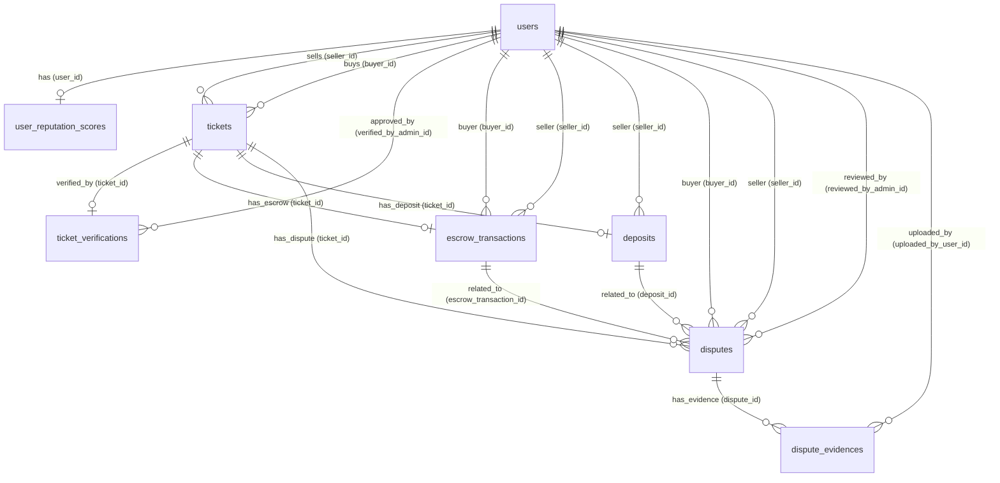

# 03 - Database Schema và Mô hình quan hệ

> **Tài liệu này dựa trên file migration duy nhất là `src/main/resources/db/migration/V1__init_schema.sql`.**
> Mọi thay đổi về cấu trúc bảng trong tương lai phải được cập nhật vào cả script Flyway mới lẫn tài liệu này.

## 1. Nguyên tắc thiết kế (KHÔNG dùng Foreign Key)

Như đã thống nhất trong kiến trúc hệ thống, để đảm bảo 3 người có thể code độc lập và dễ dàng scale/tách microservice sau này, toàn bộ database **không sử dụng Foreign Key constraint**. 

Các module tham chiếu đến nhau bằng **ID thuần (kểu Long)**. Việc đảm bảo tính toàn vẹn dữ liệu được thực hiện ở tầng Application (các Use Case) thay vì ở tầng Database.

## 2. Sơ đồ thực thể liên kết (ERD)

Sơ đồ dưới đây minh hoạ các mối quan hệ logic (dù không có FK vật lý) giữa các bảng.

## 3. Danh sách các bảng và Quyền sở hữu

Mỗi bảng thuộc về một module nhất định. Chỉ module sở hữu mới được quyền ghi/xóa (INSERT/UPDATE/DELETE) vào bảng đó. Các module khác nếu cần đọc phải đi qua API/Interface của module sở hữu.

### 3.1. Bảng `users`
- **Module:** `user`
- **Sở hữu:** Người C
- **Vai trò:** Lưu trữ thông tin tài khoản, mật khẩu (đã băm), trạng thái xác minh, thông tin ngân hàng. Đóng vai trò là thông tin gốc cho mọi người dùng trong hệ thống.
- **Index quan trọng:** `email` (Unique).

### 3.2. Bảng `user_reputation_scores`
- **Module:** `reputation`
- **Sở hữu:** Người C
- **Vai trò:** Lưu điểm uy tín (0 - 100) và các thống kê giao dịch của user. Được cập nhật bất đồng bộ qua Domain Events.
- **Index quan trọng:** `user_id` (Unique), `score` (Index để xếp hạng).

### 3.3. Bảng `tickets`
- **Module:** `ticket`
- **Sở hữu:** Người A
- **Vai trò:** Lưu thông tin vé đăng bán. Đây là entity trung tâm, mọi trạng thái của giao dịch đều xoay quanh vé.
- **Tham chiếu (ID thuần):** `seller_id`, `buyer_id`, `escrow_transaction_id`, `deposit_id`.
- **Index quan trọng:** `qr_payload_hash` (Để check vé trùng), `status`, `dispute_window_closes_at`.
- **Version kiểm soát đồng thời:** Có trường `@Version` để khóa lạc quan (Optimistic Locking) tránh trường hợp 2 người cùng bấm mua 1 vé.

### 3.4. Bảng `ticket_verifications`
- **Module:** `verification`
- **Sở hữu:** Người A
- **Vai trò:** Lưu kết quả xác thực vé: kết quả chạy OCR, check QR trùng, kết quả parse email forward.
- **Tham chiếu (ID thuần):** `ticket_id`, `duplicate_of_ticket_id`, `verified_by_admin_id`.

### 3.5. Bảng `escrow_transactions`
- **Module:** `payment`
- **Sở hữu:** Người B
- **Vai trò:** Giao dịch giữ tiền của người mua (100% giá bán) và chứa các số liệu tiền tệ như phí hoa hồng, thuế.
- **Tham chiếu (ID thuần):** `ticket_id`, `buyer_id`, `seller_id`.
- **Index quan trọng:** `gateway_transaction_id` (Đối soát với bên cổng thanh toán).

### 3.6. Bảng `deposits`
- **Module:** `payment`
- **Sở hữu:** Người B
- **Vai trò:** Lưu thông tin cọc của người bán (mặc định 50% giá bán). Chứa công thức chia tiền tịch thu cọc khi người bán thua khiếu nại.
- **Tham chiếu (ID thuần):** `ticket_id`, `seller_id`.

### 3.7. Bảng `disputes`
- **Module:** `dispute`
- **Sở hữu:** Người B
- **Vai trò:** Hoạt động khiếu nại. Chứa toàn bộ mốc thời gian mở khiếu nại, hạn chót phản hồi và phán quyết của Admin.
- **Tham chiếu (ID thuần):** `ticket_id`, `buyer_id`, `seller_id`, `escrow_transaction_id`, `deposit_id`, `reviewed_by_admin_id`.

### 3.8. Bảng `dispute_evidences`
- **Module:** `dispute`
- **Sở hữu:** Người B
- **Vai trò:** Quản lý file bằng chứng tải lên (hình ảnh/video). Chỉ lưu đường dẫn `storage_key`, file thực tế do `FileStorageService` nắm giữ.
- **Tham chiếu (ID thuần):** `dispute_id`, `uploaded_by_user_id`.
