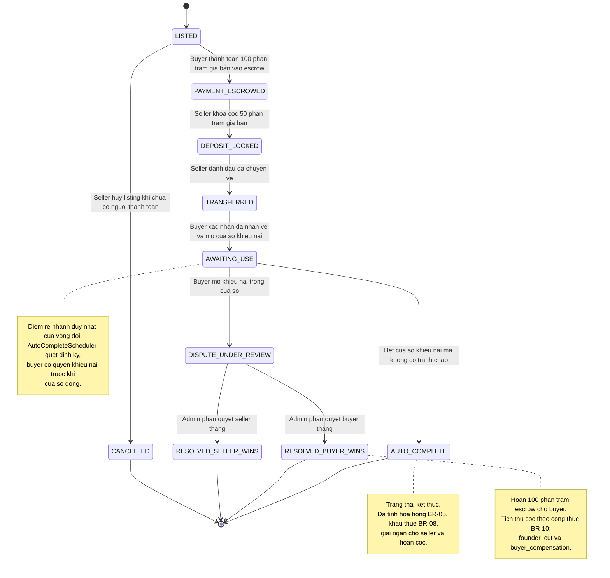

# State machine của giao dịch vé

Tài liệu đặc tả vòng đời của một giao dịch vé qua chín trạng thái: sơ đồ chuyển đổi, bảng chuyển trạng thái hợp lệ kèm tác dụng phụ, danh sách các chuyển đổi bị cấm và lý do, cùng các bất biến mà mọi đoạn code chạm vào `Ticket.status` phải tôn trọng.

## 1. Vì sao cần một state machine tường minh

Một giao dịch trên TicketPass đi qua nhiều bước, mỗi bước do một tác nhân khác nhau kích hoạt (người bán, người mua, admin, scheduler), và **mỗi bước đều gắn với một thao tác tiền không thể hoàn tác dễ dàng**. Nếu để mỗi service tự do gán `ticket.setStatus(...)` ở bất cứ đâu thì hai hậu quả gần như chắc chắn xảy ra:

1. **Chuyển trạng thái sai thứ tự.** Ví dụ vé nhảy thẳng từ `LISTED` sang `TRANSFERRED` vì một controller gọi nhầm — người bán đã giao vé mà không có đồng nào trong escrow và không có cọc nào bị khoá. Không có gì bảo vệ người bán, và cũng không có gì bảo vệ người mua ở chiều ngược lại.
2. **Không biết trạng thái nào là hợp lệ.** Khi logic rải rác ở mười nơi, không ai trả lời được câu hỏi "từ `AWAITING_USE` đi được đâu" ngoài việc đọc hết cả codebase.

Vì vậy dự án gom toàn bộ luật chuyển trạng thái vào **một class duy nhất**: `TicketStateMachineService`. Đây cũng chính là hiện thực của **State pattern** trong đồ án — trạng thái không chỉ là một cái nhãn, mà quyết định hành vi nào được phép xảy ra tiếp theo.

## 2. Chín trạng thái

| Trạng thái | Ý nghĩa | Tiền của buyer đang ở đâu | Cọc của seller đang ở đâu |
|---|---|---|---|
| `LISTED` | Vé đã qua xác thực (hoặc admin đã duyệt) và đang hiển thị công khai trên sàn | Chưa có | Chưa có |
| `PAYMENT_ESCROWED` | Người mua đã thanh toán, tiền nằm trong escrow của sàn | Trong escrow (`EscrowStatus.HELD`) | Chưa có |
| `DEPOSIT_LOCKED` | Người bán đã khoá cọc 50%, đủ điều kiện để chuyển vé | Trong escrow | Bị khoá (`DepositStatus.LOCKED`) |
| `TRANSFERRED` | Người bán báo đã chuyển vé, đang chờ người mua xác nhận | Trong escrow | Bị khoá |
| `AWAITING_USE` | Người mua đã xác nhận nhận vé, cửa sổ khiếu nại đang chạy | Trong escrow | Bị khoá |
| `AUTO_COMPLETE` | Hết cửa sổ khiếu nại không tranh chấp, đã giải ngân và hoàn cọc | Đã giải ngân cho người bán | Đã hoàn cho người bán |
| `DISPUTE_UNDER_REVIEW` | Người mua đã khiếu nại, đang chờ người bán phản hồi và admin phán quyết | Vẫn trong escrow, bị đóng băng | Vẫn bị khoá, bị đóng băng |
| `RESOLVED_BUYER_WINS` | Admin phán quyết người mua thắng | Đã hoàn 100% cho người mua | Đã bị tịch thu và chia theo BR-10 |
| `RESOLVED_SELLER_WINS` | Admin phán quyết người bán thắng | Đã giải ngân cho người bán | Đã hoàn cho người bán |

Hai cột cuối là cách nhanh nhất để kiểm tra một chuyển trạng thái có hợp lý không: **trạng thái của vé và trạng thái của tiền phải luôn khớp nhau**. Vé ở `DEPOSIT_LOCKED` mà không tìm thấy bản ghi `Deposit` nào là dữ liệu hỏng.

Cùng chín trạng thái đó, nhìn theo góc "ai đẩy vé vào đây và từ đây đi được đâu":

| Trạng thái | Ai gây ra chuyển đổi **vào** trạng thái này | Trạng thái kế tiếp hợp lệ |
|---|---|---|
| `LISTED` | Người bán (đăng vé, hệ thống tự duyệt khi bậc LOW/MEDIUM đạt ngưỡng OCR), hoặc admin (duyệt tay khi bậc HIGH) | `PAYMENT_ESCROWED`, `CANCELLED` |
| `PAYMENT_ESCROWED` | Người mua (thanh toán thành công qua MoMo Test) | `DEPOSIT_LOCKED` |
| `DEPOSIT_LOCKED` | Người bán (khoá cọc thành công qua MoMo Test) | `TRANSFERRED` |
| `TRANSFERRED` | Người bán (bấm "Đã chuyển vé") | `AWAITING_USE` |
| `AWAITING_USE` | Người mua (bấm "Đã nhận vé") | `AUTO_COMPLETE`, `DISPUTE_UNDER_REVIEW` |
| `AUTO_COMPLETE` | Hệ thống (`AutoCompleteScheduler`) | — (kết thúc) |
| `DISPUTE_UNDER_REVIEW` | Người mua (mở khiếu nại trong cửa sổ) | `RESOLVED_BUYER_WINS`, `RESOLVED_SELLER_WINS` |
| `RESOLVED_BUYER_WINS` | Admin (phán quyết) | — (kết thúc) |
| `RESOLVED_SELLER_WINS` | Admin (phán quyết) | — (kết thúc) |

`CANCELLED` xuất hiện ở cột "trạng thái kế tiếp" của `LISTED` nhưng **không được tính trong chín trạng thái chính**, vì nó không thuộc vòng đời của một *giao dịch* — không có escrow, không có cọc, không có dòng tiền nào. Chi tiết ở mục 10.

## 3. Sơ đồ chuyển trạng thái



Nhãn trong sơ đồ viết không dấu để bảo đảm Mermaid render đúng trên GitHub ở mọi phiên bản; phần diễn giải có dấu nằm ở văn bản quanh sơ đồ.

`CANCELLED` được vẽ trong sơ đồ để thấy đủ mọi lối ra khỏi `LISTED`, nhưng như đã nói ở mục 2, nó không được tính là một trong chín trạng thái giao dịch.

Đọc sơ đồ theo hai đường:

- **Đường thành công (happy path):** `LISTED` → `PAYMENT_ESCROWED` → `DEPOSIT_LOCKED` → `TRANSFERRED` → `AWAITING_USE` → `AUTO_COMPLETE`. Năm bước tuyến tính, không có nhánh rẽ, mỗi bước do một tác nhân khác nhau kích hoạt và không ai được bỏ qua bước của mình.
- **Đường tranh chấp:** rẽ ra tại `AWAITING_USE` sang `DISPUTE_UNDER_REVIEW`, rồi hội tụ về một trong hai kết cục `RESOLVED_BUYER_WINS` hoặc `RESOLVED_SELLER_WINS`.

Toàn bộ vòng đời **không có cạnh quay lui**: không trạng thái nào đi ngược về trạng thái trước đó. Đây là chủ ý thiết kế, vì mỗi bước đi tới đều kèm một thao tác tiền, mà tiền đã chuyển thì không "lùi" được bằng cách đổi một cái enum.

## 4. Bảng chuyển trạng thái hợp lệ

| Trạng thái hiện tại | Trạng thái đích cho phép | Ai/cái gì kích hoạt | Class chịu trách nhiệm | Tác dụng phụ |
|---|---|---|---|---|
| *(vé mới tạo)* | `LISTED` | Hệ thống tự duyệt khi `RiskTier` là LOW/MEDIUM và OCR đạt ngưỡng; hoặc admin duyệt tay khi bậc HIGH | `ValidateTicketService`, `RiskTierResolver`, `TicketStateMachineService` | Lưu `TicketVerification` với `VerificationStatus`; lưu `qrPayloadHash` và perceptual hash của ảnh vé; vé xuất hiện trên trang danh sách công khai |
| `LISTED` | `PAYMENT_ESCROWED` | Người mua, sau khi MoMo Test xác nhận thanh toán thành công | `HoldFundsUseCase` gọi `PaymentGateway.charge(...)`, rồi `TicketStateMachineService.transition(...)` | Tạo `EscrowTransaction` với `EscrowStatus.HELD`, ghi `amount` = giá bán và `buyerFeeAmount`; ghi `buyerId` vào `Ticket`; vé bị gỡ khỏi danh sách mua được để người khác không mua trùng |
| `PAYMENT_ESCROWED` | `DEPOSIT_LOCKED` | Người bán, sau khi MoMo Test xác nhận thu cọc | `LockDepositUseCase` | Tạo `Deposit` với `DepositStatus.LOCKED`, số tiền bằng 50% giá bán theo BR-04; mở khoá nút "Đã chuyển vé" cho người bán |
| `DEPOSIT_LOCKED` | `TRANSFERRED` | Người bán bấm "Đã chuyển vé" sau khi thực hiện theo `TransferInstruction` | `TransferTicketService` | Ghi `transferredAt`; sinh `TransferInstruction` tương ứng từ `TicketAdapter` của loại vé và hiển thị cho hai bên; thông báo cho người mua vào xác nhận |
| `TRANSFERRED` | `AWAITING_USE` | Người mua bấm "Đã nhận vé" | `TicketController` → `TicketStateMachineService` | Ghi `receivedAt`; tính `windowCloseAt` bằng `DisputeWindowPolicy.computeWindowClose(...)` theo BR-09; vé lọt vào phạm vi quét của `AutoCompleteScheduler` |
| `AWAITING_USE` | `AUTO_COMPLETE` | `AutoCompleteScheduler` chạy định kỳ, phát hiện `now > windowCloseAt` và không có tranh chấp mở | `AutoCompleteScheduler`, `CommissionCalculatorService`, `TaxWithholdingService`, `ReleaseFundsUseCase` | Tính `CommissionBreakdown` (BR-05 đến BR-07) và `TaxWithholding` (BR-08); giải ngân phần còn lại cho người bán; hoàn 100% cọc; `EscrowStatus` → `RELEASED`, `DepositStatus` → `REFUNDED`; publish `TicketTransactionCompletedEvent` với `CompletionReason.AUTO_COMPLETE` |
| `AWAITING_USE` | `DISPUTE_UNDER_REVIEW` | Người mua mở khiếu nại trước khi `windowCloseAt` | `FileDisputeUseCase` | Tạo `Dispute` với `DisputeStatus` mở và `DisputeReason` tương ứng; lưu file bằng chứng qua `FileStorageService`; đặt hạn phản hồi của người bán (mặc định 24 giờ); đóng băng escrow và cọc; `AutoCompleteScheduler` bỏ qua vé này |
| `DISPUTE_UNDER_REVIEW` | `RESOLVED_BUYER_WINS` | Admin phán quyết trên trang quản trị | `ReviewDisputeUseCase`, `RefundBuyerUseCase`, `ForfeitDepositPolicy` | Hoàn 100% escrow và hoàn phí người mua; tính `ForfeitBreakdown` theo BR-10, sàn giữ `founder_cut`, chuyển `buyer_compensation` cho người mua; `EscrowStatus` → `REFUNDED`, `DepositStatus` → `FORFEITED`; publish `DisputeResolvedEvent` với `DisputeOutcome.BUYER_WINS` → uy tín người bán −15, người mua +1 |
| `DISPUTE_UNDER_REVIEW` | `RESOLVED_SELLER_WINS` | Admin phán quyết trên trang quản trị | `ReviewDisputeUseCase`, `CommissionCalculatorService`, `TaxWithholdingService`, `ReleaseFundsUseCase` | Giải ngân và hoàn cọc y hệt nhánh `AUTO_COMPLETE`; publish `DisputeResolvedEvent` với `DisputeOutcome.SELLER_WINS` → uy tín người bán +1, và `TicketTransactionCompletedEvent` với `CompletionReason.DISPUTE_RESOLVED` → cộng điểm giao dịch hoàn tất |

### 4.1 Ma trận chuyển đổi hợp lệ (from → to)

Cùng thông tin trên, viết dưới dạng ma trận để tra nhanh khi hiện thực và khi viết test. Ký hiệu **OK** là hợp lệ; ô trống là bị chặn và phải ném `IllegalTicketTransitionException`.

| From \ To | LISTED | PAYMENT_ESCROWED | DEPOSIT_LOCKED | TRANSFERRED | AWAITING_USE | AUTO_COMPLETE | DISPUTE_UNDER_REVIEW | RESOLVED_BUYER_WINS | RESOLVED_SELLER_WINS | CANCELLED |
|---|---|---|---|---|---|---|---|---|---|---|
| **LISTED** | | OK | | | | | | | | OK |
| **PAYMENT_ESCROWED** | | | OK | | | | | | | |
| **DEPOSIT_LOCKED** | | | | OK | | | | | | |
| **TRANSFERRED** | | | | | OK | | | | | |
| **AWAITING_USE** | | | | | | OK | OK | | | |
| **AUTO_COMPLETE** | | | | | | | | | | |
| **DISPUTE_UNDER_REVIEW** | | | | | | | | OK | OK | |
| **RESOLVED_BUYER_WINS** | | | | | | | | | | |
| **RESOLVED_SELLER_WINS** | | | | | | | | | | |
| **CANCELLED** | | | | | | | | | | |

Tổng cộng **chín** chuyển đổi hợp lệ. Ba đặc điểm của ma trận cần giữ đúng khi hiện thực:

- **Không có ô nào dưới đường chéo theo thứ tự vòng đời**, tức là không có chuyển đổi lùi. Một giao dịch không quay lại trạng thái trước.
- **Đường chéo hoàn toàn trống**, tức là không có tự chuyển về chính mình. Xem lý do ở mục 6.
- **Bốn hàng cuối trống hoàn toàn** (`AUTO_COMPLETE`, `RESOLVED_BUYER_WINS`, `RESOLVED_SELLER_WINS`, `CANCELLED`) vì đó là các trạng thái kết thúc.

Một quan sát đáng chú ý khi đọc cột "Ai/cái gì kích hoạt": **không có hai bước liên tiếp nào do cùng một tác nhân kích hoạt** trên đường happy path. Người mua trả tiền, người bán khoá cọc, người bán chuyển vé, người mua xác nhận, hệ thống hoàn tất. Sự luân phiên này chính là thứ khiến không bên nào tự đẩy giao dịch đi tới một mình.

## 5. Trạng thái kết thúc (terminal)

Ba trạng thái sau là **terminal** — không có bất kỳ chuyển đổi hợp lệ nào đi ra khỏi chúng:

| Trạng thái terminal | Kết cục | Tiền đã đi đâu |
|---|---|---|
| `AUTO_COMPLETE` | Giao dịch thành công, không tranh chấp | Người bán nhận `giá bán − phí seller − thuế` cộng hoàn cọc; sàn giữ tổng phí |
| `RESOLVED_BUYER_WINS` | Tranh chấp, người mua thắng | Người mua nhận `giá bán + phí buyer + buyer_compensation`; sàn giữ `founder_cut`; người bán mất trắng cọc |
| `RESOLVED_SELLER_WINS` | Tranh chấp, người bán thắng | Giống hệt `AUTO_COMPLETE` |

Lý do phải là terminal: ở cả ba trạng thái, **tiền đã rời khỏi escrow và đã sang tài khoản thật của người dùng qua cổng thanh toán**. Đổi trạng thái thêm một lần nữa sẽ tạo ra bất nhất giữa cái enum trong cơ sở dữ liệu và thực tế dòng tiền ngoài hệ thống. Nếu sau này phát hiện phán quyết sai, quy trình đúng là **mở một giao dịch bồi hoàn mới**, có bút toán riêng và dấu vết kiểm toán riêng, chứ không phải sửa trạng thái của giao dịch cũ.

Về mặt code, `TicketStateMachineService` khai báo danh sách trạng thái đích của ba trạng thái này là tập rỗng, nên mọi lời gọi `transition(...)` từ chúng đều ném exception mà không cần viết thêm điều kiện đặc biệt nào.

## 6. Chuyển trạng thái bị cấm

Bảng dưới liệt kê những chuyển đổi trông có vẻ hợp lý nhưng bị cấm, kèm lý do. Đây đồng thời là danh sách test case bắt buộc cho `TicketStateMachineService`: mỗi dòng phải có một test khẳng định `IllegalTicketTransitionException` được ném ra.

| Chuyển đổi bị cấm | Vì sao cấm |
|---|---|
| `LISTED` → `TRANSFERRED` | **Chưa có tiền trong escrow.** Người bán sẽ giao vé cho một người chưa trả đồng nào, và cũng chưa khoá cọc nên không có gì ràng buộc hai bên. Đây đúng là kịch bản mà cả sàn sinh ra để ngăn chặn. |
| `LISTED` → `DEPOSIT_LOCKED` | Chưa có người mua nào. Khoá cọc khi chưa biết bán cho ai là chôn vốn của người bán vô nghĩa, và không có escrow tương ứng để đối chiếu số tiền cọc. |
| `PAYMENT_ESCROWED` → `TRANSFERRED` | **Bỏ qua bước khoá cọc.** Người bán giao vé mà không có "da trong cuộc": nếu vé giả, sàn không có nguồn nào để bồi thường người mua ngoài chính tiền escrow, tức là người mua tự bồi thường cho mình. Toàn bộ giá trị của BR-04 biến mất. |
| `PAYMENT_ESCROWED` → `AUTO_COMPLETE` | Giải ngân cho người bán trong khi vé chưa từng được chuyển và người mua chưa xác nhận gì. |
| `DEPOSIT_LOCKED` → `AWAITING_USE` | Bỏ qua `TRANSFERRED`. Người mua xác nhận đã nhận một thứ mà người bán chưa hề báo là đã gửi — cửa sổ khiếu nại sẽ bắt đầu chạy trên một sự kiện không tồn tại. |
| `TRANSFERRED` → `DISPUTE_UNDER_REVIEW` | Cửa sổ khiếu nại **chưa bắt đầu** vì `windowCloseAt` chỉ được tính khi vào `AWAITING_USE`. Nếu người mua chưa nhận được vé, con đường đúng là **không** bấm xác nhận; quá hạn thì `AutoCompleteScheduler` chuyển hồ sơ cho admin, chứ không phải mở tranh chấp trên một cửa sổ chưa tồn tại. |
| `AWAITING_USE` → `RESOLVED_BUYER_WINS` | Bỏ qua `DISPUTE_UNDER_REVIEW`, tức là tịch thu cọc của người bán mà **chưa hề có tranh chấp nào được mở, chưa có bằng chứng, chưa cho người bán cơ hội phản hồi**. Đây là chuyển đổi nguy hiểm nhất trong danh sách vì nó cho phép lấy tiền của một người không có cơ hội tự bảo vệ. |
| `AUTO_COMPLETE` → `DISPUTE_UNDER_REVIEW` | **Đã giải ngân rồi.** Tiền đã sang tài khoản MoMo của người bán và cọc đã hoàn; sàn không còn giữ khoản nào để đóng băng hay tịch thu. Mở tranh chấp lúc này chỉ tạo ra một hồ sơ mà admin phán quyết kiểu gì cũng không thực thi được. |
| `RESOLVED_BUYER_WINS` → `RESOLVED_SELLER_WINS` | Lật ngược phán quyết bằng cách sửa enum, trong khi tiền đã hoàn cho người mua và cọc đã bị tịch thu. Muốn sửa sai thì mở giao dịch bồi hoàn mới. |
| Bất kỳ trạng thái nào → chính nó | Chuyển đổi rỗng thường là dấu hiệu request bị gửi trùng (người dùng bấm hai lần, hoặc callback của MoMo gọi lại). Cấm tường minh để lỗi lộ ra ngay thay vì âm thầm chạy lại tác dụng phụ lần thứ hai — chạy `ReleaseFundsUseCase` hai lần nghĩa là trả tiền cho người bán hai lần. |

Mọi vi phạm đều ném `IllegalTicketTransitionException` từ `TicketStateMachineService.assertCanTransition(...)`. Exception này kế thừa `BusinessRuleViolationException` và được `GlobalExceptionHandler` bắt, trả về HTTP 409 Conflict kèm thông điệp tiếng Việt cho người dùng, đồng thời ghi log ở mức WARN với đầy đủ `ticketId`, trạng thái nguồn và trạng thái đích.

## 7. `TicketStateMachineService` là nơi duy nhất đổi trạng thái

**Luật.** Không có bất kỳ chỗ nào khác trong toàn bộ codebase được gọi `ticket.setStatus(...)`. Mọi thay đổi trạng thái phải đi qua `TicketStateMachineService.transition(ticketId, targetStatus)`. Setter `setStatus` để mức truy cập `protected` hoặc package-private trong `Ticket` để trình biên dịch tự chặn thay vì trông chờ vào kỷ luật của con người.

Điều này khiến bảng ở mục 4 và mục 6 có **đúng một nơi hiện thực**, và đọc một class là biết toàn bộ luật.

```java
// ticket/domain/TicketStatus.java
public enum TicketStatus {
    LISTED,
    PAYMENT_ESCROWED,
    DEPOSIT_LOCKED,
    TRANSFERRED,
    AWAITING_USE,
    AUTO_COMPLETE,
    DISPUTE_UNDER_REVIEW,
    RESOLVED_BUYER_WINS,
    RESOLVED_SELLER_WINS
}
```

```java
// ticket/application/TicketStateMachineService.java
@Service
@RequiredArgsConstructor
public class TicketStateMachineService {

    private static final Map<TicketStatus, Set<TicketStatus>> ALLOWED =
        new EnumMap<>(Map.of(
            TicketStatus.LISTED,               EnumSet.of(TicketStatus.PAYMENT_ESCROWED),
            TicketStatus.PAYMENT_ESCROWED,     EnumSet.of(TicketStatus.DEPOSIT_LOCKED),
            TicketStatus.DEPOSIT_LOCKED,       EnumSet.of(TicketStatus.TRANSFERRED),
            TicketStatus.TRANSFERRED,          EnumSet.of(TicketStatus.AWAITING_USE),
            TicketStatus.AWAITING_USE,         EnumSet.of(TicketStatus.AUTO_COMPLETE,
                                                          TicketStatus.DISPUTE_UNDER_REVIEW),
            TicketStatus.DISPUTE_UNDER_REVIEW, EnumSet.of(TicketStatus.RESOLVED_BUYER_WINS,
                                                          TicketStatus.RESOLVED_SELLER_WINS),
            TicketStatus.AUTO_COMPLETE,        EnumSet.noneOf(TicketStatus.class),
            TicketStatus.RESOLVED_BUYER_WINS,  EnumSet.noneOf(TicketStatus.class),
            TicketStatus.RESOLVED_SELLER_WINS, EnumSet.noneOf(TicketStatus.class)
        ));

    private final TicketRepository ticketRepository;

    public void assertCanTransition(TicketStatus from, TicketStatus to) {
        if (!ALLOWED.getOrDefault(from, EnumSet.noneOf(TicketStatus.class)).contains(to)) {
            throw new IllegalTicketTransitionException(from, to);
        }
    }

    @Transactional
    public Ticket transition(Long ticketId, TicketStatus target) {
        Ticket ticket = ticketRepository.findById(ticketId)
                .orElseThrow(() -> new ResourceNotFoundException("Không tìm thấy vé " + ticketId));
        assertCanTransition(ticket.getStatus(), target);
        ticket.applyStatus(target);           // setter nội bộ, không public
        return ticketRepository.save(ticket);
    }
}
```

Ba điểm đáng chú ý trong đoạn code trên:

- `EnumMap` và `EnumSet` được chọn thay cho `HashMap`/`HashSet` vì chúng lưu trữ bằng mảng bit chỉ số ordinal, nhanh hơn và không cần tính hash. Với một bảng tra chạy ở mọi bước giao dịch, đây là lựa chọn mặc định đúng.
- Ba trạng thái terminal được khai báo tường minh với `EnumSet.noneOf(...)` thay vì bỏ trống. Viết ra rõ ràng khiến người đọc thấy ngay "ba trạng thái này cố ý không có lối ra", chứ không phải "chắc là quên".
- `assertCanTransition` tách riêng khỏi `transition` để các use case có thể **kiểm tra trước** mà chưa ghi gì — ví dụ view cần biết có nên hiển thị nút "Đã chuyển vé" hay không.

## 8. Chống cập nhật đồng thời bằng `@Version`

`Ticket` mang một trường `@Version` để bật **optimistic locking** của JPA:

```java
@Entity
public class Ticket {
    @Id @GeneratedValue
    private Long id;

    @Enumerated(EnumType.STRING)
    @Column(nullable = false, length = 32)
    private TicketStatus status;

    @Version
    private Long version;
}
```

**Vấn đề nó giải quyết.** Hình dung hai request đến gần như cùng lúc trên một vé đang ở `AWAITING_USE`: `AutoCompleteScheduler` phát hiện cửa sổ vừa đóng và định chuyển sang `AUTO_COMPLETE`; đúng lúc đó người mua bấm khiếu nại và `FileDisputeUseCase` định chuyển sang `DISPUTE_UNDER_REVIEW`. Cả hai đều đọc được `status = AWAITING_USE`, cả hai đều thấy chuyển đổi của mình hợp lệ theo bảng ở mục 4. Nếu không có gì ngăn, kết quả là **vé vừa được giải ngân cho người bán vừa đang có tranh chấp mở** — trường hợp tồi tệ nhất, vì admin sẽ phán quyết trên một giao dịch mà tiền đã đi mất rồi.

**Cách `@Version` chặn.** Hibernate đưa số version vào mệnh đề `WHERE` khi ghi:

```sql
UPDATE ticket SET status = 'AUTO_COMPLETE', version = 8 WHERE id = 42 AND version = 7
```

Transaction nào commit trước sẽ nâng version từ 7 lên 8. Transaction còn lại chạy `UPDATE ... WHERE version = 7`, khớp **0 dòng**, Hibernate ném `OptimisticLockException` và transaction đó rollback toàn bộ — kể cả các thao tác tiền bên trong nó. Chỉ đúng một trong hai nhánh thắng, không có trạng thái lai.

**Vì sao chọn optimistic thay vì pessimistic.** Va chạm thực tế cực hiếm: hai request phải rơi vào đúng cùng một vé trong khoảng vài mili giây. Khoá bi quan (`SELECT ... FOR UPDATE`) sẽ bắt mọi request bình thường phải chờ khoá để phòng một tình huống gần như không xảy ra, và mở ra nguy cơ deadlock khi một use case chạm nhiều bảng. Optimistic locking không tốn gì ở đường chạy bình thường và chỉ trả giá đúng lúc thật sự có va chạm.

**Cách xử lý khi bắt được.** `GlobalExceptionHandler` bắt `OptimisticLockException` và trả HTTP 409 Conflict kèm thông điệp "Trạng thái vé vừa thay đổi, vui lòng tải lại trang". Riêng `AutoCompleteScheduler` nuốt exception này và ghi log ở mức INFO thay vì báo lỗi, vì thua cuộc đua với một khiếu nại hợp lệ là hành vi đúng — lần quét sau vé đã ở `DISPUTE_UNDER_REVIEW` nên scheduler sẽ tự bỏ qua.

## 9. Các bất biến phải luôn đúng

Danh sách này dùng làm assertion trong integration test. Nếu một bất biến bị vi phạm, dữ liệu đã hỏng, kể cả khi không có exception nào được ném ra.

| # | Bất biến | Kiểm tra thế nào |
|---|---|---|
| 1 | Vé ở `PAYMENT_ESCROWED` trở đi luôn có đúng một `EscrowTransaction` | Đếm bản ghi theo `ticketId`, phải bằng 1 |
| 2 | Vé ở `DEPOSIT_LOCKED` trở đi luôn có đúng một `Deposit` với số tiền bằng 50% giá bán | So sánh `Deposit.amount` với `Ticket.salePrice / 2` |
| 3 | Vé ở `AWAITING_USE` luôn có `windowCloseAt` khác null và không muộn hơn `eventStartAt` | Khẳng định theo BR-09 |
| 4 | Ở mọi trạng thái terminal, `EscrowStatus` không còn là `HELD` | `RELEASED` với hai nhánh hoàn tất, `REFUNDED` với nhánh người mua thắng |
| 5 | Ở mọi trạng thái terminal, tổng tiền ra bằng tổng tiền vào | Xem ba kịch bản đối chiếu ở cuối tài liệu quy tắc nghiệp vụ |
| 6 | Không có `Dispute` nào tồn tại cho vé chưa từng đi qua `AWAITING_USE` | Truy vấn đối chiếu `Dispute.ticketId` với lịch sử trạng thái |
| 7 | `Ticket.version` chỉ tăng, không bao giờ giảm | Do JPA bảo đảm, kiểm tra thêm khi viết migration bằng tay |

## 10. Ghi chú về huỷ listing

Huỷ listing **không phải** là một trạng thái trong chín trạng thái trên, vì nó không thuộc vòng đời của một *giao dịch*:

- Khi vé còn ở `LISTED` và chưa có người mua nào thanh toán, người bán được gỡ vé khỏi sàn tự do. Không có tiền nào liên quan, không ảnh hưởng điểm uy tín, vé đơn giản là không còn hiển thị.
- Khi vé đã sang `PAYMENT_ESCROWED` trở đi, người bán **không có quyền huỷ đơn phương** — tiền của người mua đang bị giữ trong escrow. Nếu người bán bỏ ngang, con đường xử lý là người mua khiếu nại theo BR-09 và tuyến `DISPUTE_UNDER_REVIEW` → `RESOLVED_BUYER_WINS` giải quyết. Mức phạt uy tín −10 ở BR-11 áp cho trường hợp người bán chủ động xin huỷ và được admin chấp thuận trong quá trình xử lý tranh chấp; mức phạt này nhẹ hơn −15 của thua tranh chấp vì thừa nhận sớm giúp giải phóng tiền của người mua nhanh hơn.

## 11. Đọc tiếp

| Tài liệu | Nội dung |
|---|---|
| [00-tong-quan-du-an.md](00-tong-quan-du-an.md) | Bài toán, phạm vi, luồng nghiệp vụ tổng quan, năm lớp chống scam. |
| [01-kien-truc-he-thong.md](01-kien-truc-he-thong.md) | Cây package, chiều phụ thuộc giữa các layer, bốn nguyên tắc scalability. |
| [04-quy-tac-nghiep-vu.md](04-quy-tac-nghiep-vu.md) | BR-01 đến BR-11: hoa hồng, phí tối thiểu, cọc, công thức tịch thu, thuế, cửa sổ khiếu nại, điểm uy tín. |
